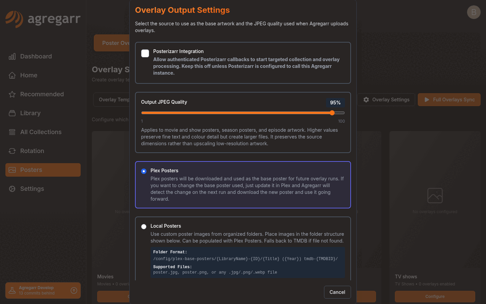
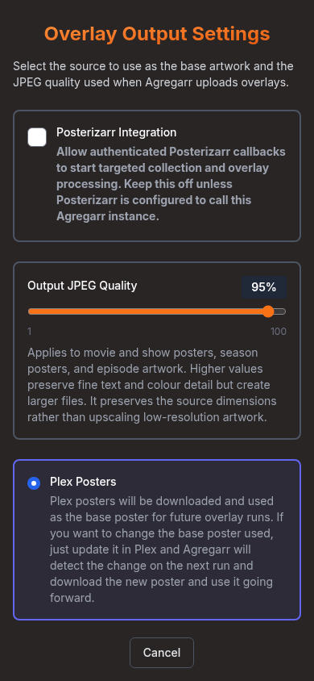
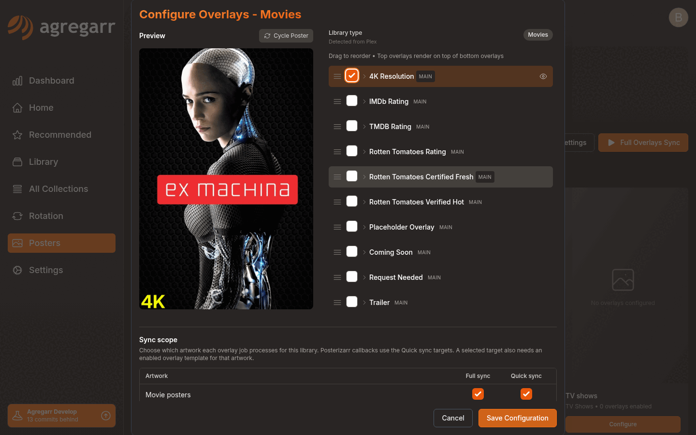
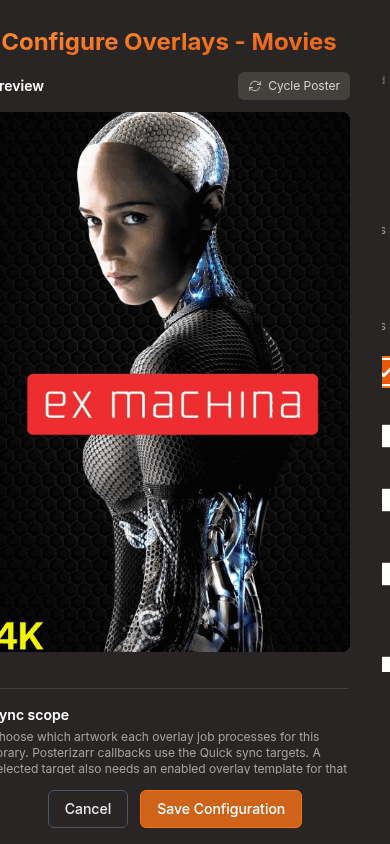
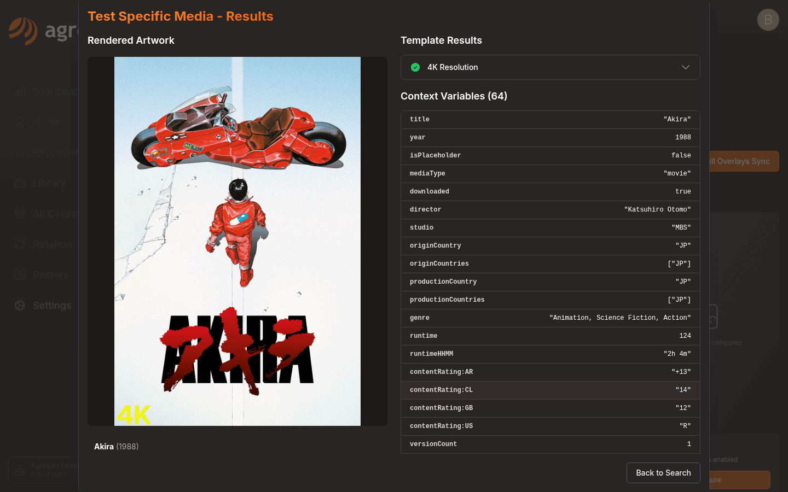
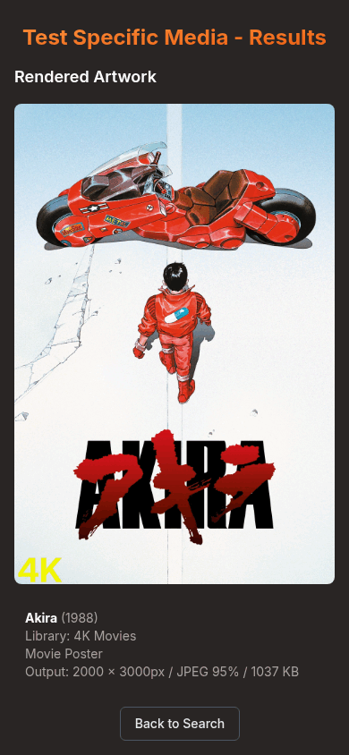

# Your first overlay

By the end of this page, your 4K movies will have a yellow **4K** badge on their Plex posters. You'll also know how to remove it.

An overlay is a badge or banner that Agregarr draws over a poster and uploads to Plex. You'll use one of the ready-made presets, so there's nothing to design.

## What you need

- Agregarr connected to Plex, with [Discover run](first-collection.md) so the sidebar is unlocked.
- A Plex movie library containing at least one 4K title.

## Set it up

### 1. Open the library list

1. Open **Posters** in the sidebar, then choose the **Poster Overlays** tab. The page is called **Overlay System**.
2. Click **Library Configuration**.

The first time you open **Library Configuration**, the **Overlay Output Settings** window opens by itself. It asks where Agregarr should get the poster it draws badges on. If you cancel, it'll open again next time.

### 2. Choose the base poster

In **Overlay Output Settings**, choose **Plex Posters**, then click **Continue**.

**Plex Posters** keeps the artwork currently showing in Plex. The first time Agregarr overlays a title, it saves a copy of that poster and draws on the copy. That stops the badge stacking on top of an older badge. **Reset Library**, covered at the end of this page, puts the saved copy back.
<!-- OPEN: M20/M24 base-poster default stays TMDB until the overlay-marker guard lands (feature/base-poster-guard) -->

Leave **Output JPEG Quality** and **Posterizarr Integration** as they are.

=== "Desktop"

    

=== "Phone"

    

A **Downloading Base Posters** window may appear briefly. If it hangs around, click **Run in Background**.

**Check:** the window closes and each library has a card reading "No overlays configured".

!!! warning
    If a tool such as Kometa has already added badges to your Plex posters, reset them to clean artwork in Plex before choosing Plex Posters. Agregarr uses whatever Plex is currently showing as the original.

### 3. Switch on 4K Resolution

1. Click **Configure** on your movie library's card. The **Configure Overlays** window opens with the library name in its title.
2. Find **4K Resolution** and tick its checkbox. Click the arrow beside the name to read the description. The description says it applies to items whose resolution is 4K.
3. Leave **Sync scope** alone. **Movie posters** is ticked for both **Full sync** and **Quick sync**.
4. Click **Save Configuration**.

=== "Desktop"

    

=== "Phone"

    

**Check:** the preview on the left shows a yellow **4K** badge in the bottom-left corner. After saving, the library card reads "1 overlays enabled" and has a **Sync** button.

Nothing has changed in Plex yet.

### 4. Test it on one title

1. Click **Test Specific Media** at the top of the page.
2. Enter the name of a title you know is 4K, then click **Search**.
3. Click the title, then click **Test Overlay**.

=== "Desktop"

    

=== "Phone"

    

**Check:** under **Rendered Artwork**, the poster has the **4K** badge. Under **Template Results**, **4K Resolution** has a green tick. A red cross means Plex doesn't see that title as 4K. Click the template name to find out why, then go back and choose another title.

The test draws a poster for you to inspect. It doesn't change anything in Plex. If you only want to update this title now, click **Apply Overlay to Plex** instead of waiting for step 5.

Click **Back to Search**, then **Cancel** to close the window.

### 5. Run the overlay sync

1. Click **Sync** on the library's card. The button changes to **Confirm?**.
2. Click it again within a few seconds.

A message says "Overlay sync started for" followed by the library name, and a progress card appears under **Running Jobs**. The sync checks the whole library. Titles that aren't 4K are left alone.

**Check:** the progress card disappears once the sync finishes.

Agregarr runs these jobs on its own as well. **Poster Overlay Application** does a full pass every day at 3 AM by default. **Overlay Quick Sync** adds badges to newly added titles every 30 minutes.

### 6. Check Plex

Open the title you tested in Plex. Its poster should now have the yellow **4K** badge in the bottom-left corner. The other 4K titles in that library should have it too.

If the old poster is still showing, refresh the page or restart the Plex app. Some clients keep the old image around for a while.

## Take it off again

Do these in order.

1. On the library card, click **Reset Library**, then **Reset All Posters** in the **Confirm Poster Reset** window. This restores every poster in the library from the copy Agregarr saved, which is the artwork Plex had before the overlay. A "Reset Complete" message appears when it finishes.
2. Click **Configure**, untick **4K Resolution**, then click **Save Configuration**.

Run the reset first. **Reset Library** only appears while at least one overlay is ticked. Unticking your only overlay won't remove badges already drawn on posters, because a sync has nothing to run when no overlays are ticked. If you leave the overlay ticked, the next sync adds the badges again.

## What you built

You enabled one preset for one library, checked it against a single title, ran the sync, and saw the result in Plex. Other overlays use the same process.

## Next

[Overlays](../Overlays.md): the other presets, the template editor and the rest of the overlay options.
