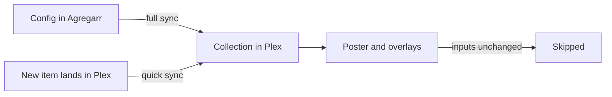

# How Agregarr works

Agregarr stores recipes and uses them to build Plex collections. These are the pieces you'll see through the rest of the guide.

## Configs and Plex collections

A **config** is the recipe saved in Agregarr. It contains the source (a Trakt list, TMDB Trending or your own library), the library, the title, how many items to include and where the collection shows. A **Plex collection** is the result Plex displays. Agregarr builds it from the config.

The config is yours. Edit it and the Plex collection follows on the next sync. If you delete the collection in Plex by hand, the config remains, and **Discover Existing Collections & Hubs** flags the collection as missing.

Agregarr also stores configs for Plex's built-in hubs, shown as **Plex Default**, and for collections it didn't create, shown as **Pre-Existing**.

## Full syncs and quick syncs

**Plex Collections Sync** is the full sync. It runs every 12 hours by default and walks every config. It refreshes the source data, rebuilds each collection's contents, updates hub visibility, sort titles and ordering in Plex, then tidies up leftovers.

**Collections Quick Sync** runs every 30 minutes by default. It only checks items Plex added since the previous run. If a new item matches something the last full sync couldn't find, quick sync adds it to the right collection. It doesn't rebuild collections.

**Overlay Quick Sync** does the same job for overlays, covering new items that don't have an overlay yet. **Poster Overlay Application** is the full overlay run. It runs every day at 3 AM by default.

Use **Run Now** under **Settings > Jobs** to start any of these jobs. The **Dashboard** starts the two full syncs.

## Input hashes

Before Agregarr redraws a poster or applies an overlay, it takes a fingerprint (a SHA-256 hash) of the inputs. Those inputs include the template, the values it reads, the collection name and the items shown.

Agregarr compares that fingerprint with the one saved last time. If they match, it skips the item and writes nothing to Plex. Change the template or an item's data and the fingerprint changes, so only that item gets redrawn. This is why a second sync is much quicker than the first.

Swapping an image file used by a template, such as a mapped icon, doesn't change the fingerprint. That item won't be redrawn until something else changes.

## What Agregarr owns in Plex

Agregarr treats a Plex collection as its own when the collection has a label starting with `Agregarr`. It sets:

- The title, sort title and content order.
- Whether the collection shows on your Home, other users' Home and the library's Recommended tab, plus its order on Home, Recommended and the Library tab.
- The collection poster, plus item posters wherever an overlay applies.
- The `Overlay` label on items with an overlay.
- The label marking the collection as Agregarr's.

If placeholders are turned on, Agregarr also writes placeholder files to disk for Plex to scan.

Agregarr doesn't touch your media files. On library items, it only changes the poster and adds an `Overlay` label where an overlay applies. With Auto Empty Trash turned on, it also empties the library's Plex trash after cleaning up placeholders.

Collections made by other tools appear as **Pre-Existing** after discovery. Agregarr can order them and set their visibility. Use **Exclude from Ordering (Plex Label)** under **Settings > General** to keep chosen collections out of that ordering.

## Related

[Finding your way around](finding-your-way.md) · [Performance](../Performance.md) · [Settings](../Settings.md#jobs) · [Collections](../collections/adopt-existing.md#variations)
