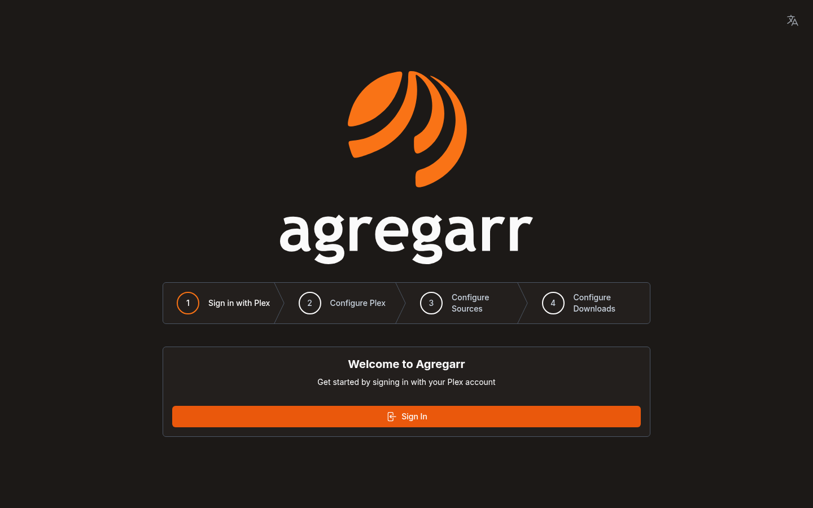
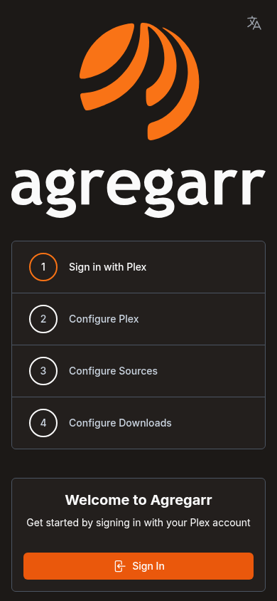

# Install with Docker Compose

This gets Agregarr running in a container so you can sign in with Plex.

## What you need

- A machine running Docker with the Compose plugin. `docker compose version` should print a version.
- A folder on that machine for Agregarr's settings, for example `/opt/agregarr/config`.
- Your host user's ID and group ID. Run `id -u` and `id -g` to find them.
- Plex Media Server 1.43.3.10861 or newer.

## Set it up

1. Create the config folder and make it yours.

    ```sh
    sudo mkdir -p /opt/agregarr/config
    sudo chown -R $(id -u):$(id -g) /opt/agregarr
    ```

    **Check:** `ls -ld /opt/agregarr/config` shows the folder.

2. Create a folder for the Compose file and move into it.

    ```sh
    mkdir -p /opt/agregarr && cd /opt/agregarr
    ```

3. Create a file called `compose.yml` in that folder and paste the following into it. Change `TZ` to your time zone. Set `PUID` and `PGID` to the numbers returned by `id -u` and `id -g`. Leave the rest alone.

    ```yaml
    services:
      agregarr:
        image: bitr8/agregarr:latest
        container_name: agregarr
        volumes:
          - /opt/agregarr/config:/app/config
        environment:
          - TZ=Australia/Sydney
          - PUID=1000
          - PGID=1000
          - UMASK=022
        ports:
          - 7171:7171
        restart: unless-stopped
    ```

    **Check:** the file has no tabs and its indentation matches the block above.

4. Start Agregarr.

    ```sh
    docker compose up -d
    ```

    **Check:** `docker compose ps` lists `agregarr` as running.

5. Open `http://YOUR_SERVER:7171` in a browser. Replace `YOUR_SERVER` with the machine's IP address or hostname. A new install opens the Setup page at step 1, **Sign in with Plex**. Click **Sign In** under "Welcome to Agregarr".

    **Check:** Plex's sign-in window opens.

<!-- OPEN: NEW: Setup wizard steps after Plex sign-in are covered by the first-run page, link once written -->

=== "Desktop"

    

=== "Phone"

    

## If the volume warning shows

If the Setup page shows an orange warning that the `/app/config` volume mount wasn't configured properly and all data will be cleared when the container stops or restarts, the config folder isn't mounted. Check the first line under `volumes:`, then run `docker compose up -d` again.


## Later, when you need it

None of these are needed for the first install.

- **Placeholder folders.** Coming Soon placeholders need folders that both Agregarr and your media apps can see. Add lines like these under `volumes:` using your own host paths, then recreate the container with `docker compose up -d`:

    ```yaml
          - /path/to/placeholder/movies:/data/movies
          - /path/to/placeholder/tv:/data/tv
    ```

    Enter the container paths into Agregarr later. See [Placeholders](../Placeholders.md).
- **Another port.** Change the left number in `7171:7171`, for example `8080:7171`. Keep the right number as `7171`.
- **File permissions.** `PUID` and `PGID` should match the user that owns your media folders. If you leave them out, the container runs as root and can create folders that your other apps can't write to.

## Next

[Updating and image tags](updating.md)
