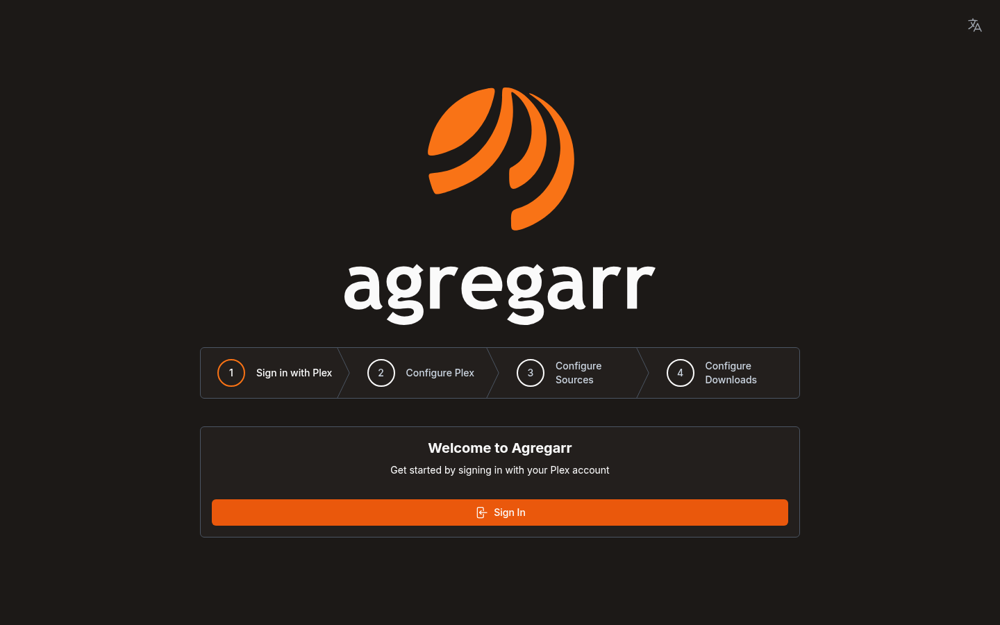
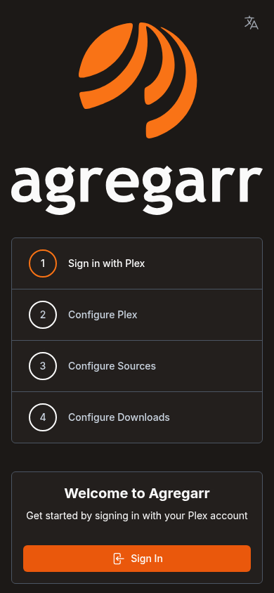
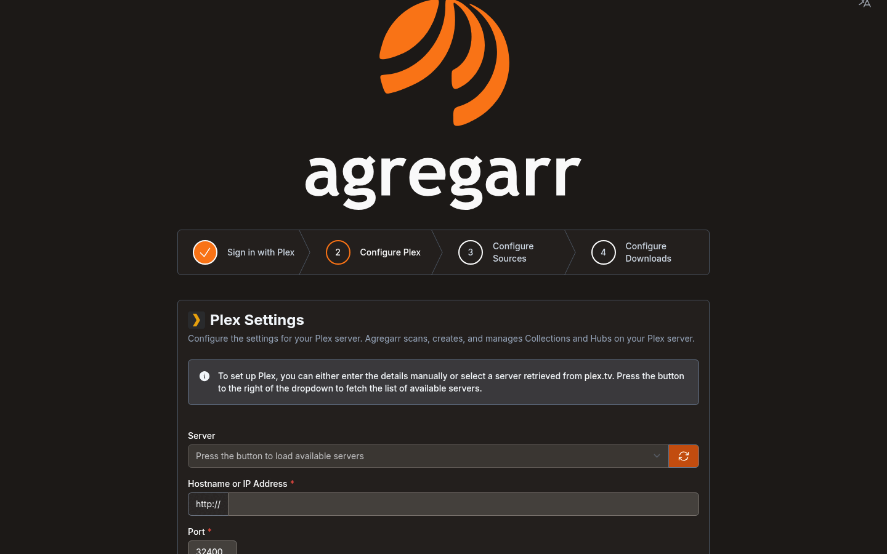
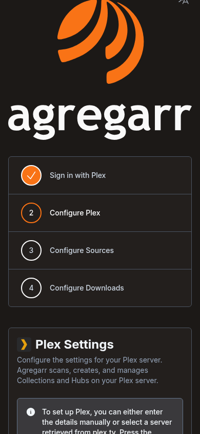
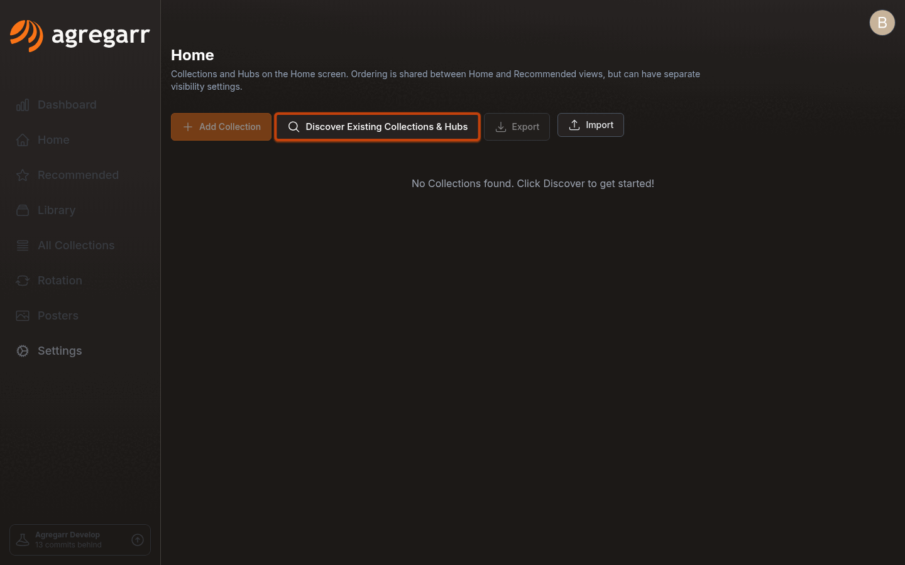
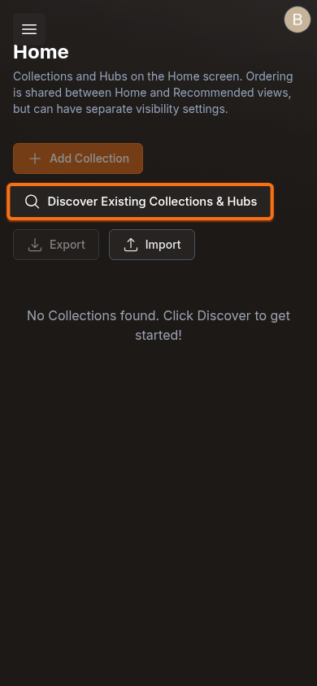

# First run: the setup wizard

Once you've finished this page, Agregarr will be signed in to your Plex account, connected to your Plex server and ready to find the collections you already have.

## What you need

- Agregarr running and reachable in a browser. If it isn't, start with [Install with Docker Compose](install-docker.md) or [Install on Unraid](install-unraid.md).
- The Plex account that owns your Plex server. The first account to sign in becomes the admin.
- The address and port of your Plex server as Agregarr sees it, for example `192.0.2.10` and `32400`.
- Pop-up windows allowed for the Agregarr address. Plex sign-in opens in one.

## Set it up

1. Open Agregarr in your browser.

    On a fresh install, every address redirects to the setup page. It shows the Agregarr logo, four numbered steps (**Sign in with Plex**, **Configure Plex**, **Configure Sources**, **Configure Downloads**) and a language icon in the top right corner.

    **Check:** the first step is highlighted, and the panel below it says **Welcome to Agregarr**.

    === "Desktop"

        

    === "Phone"

        

2. To use another language, click the language icon in the top right and choose one under **Display Language**.

    Agregarr saves the choice when you finish the wizard. You can change it later under **Settings > General**. The sign-in page doesn't have a language picker.

    **Check:** the wizard text changes to the language you chose.

3. If there's an orange warning banner above the four steps, read [The volume warning](#the-volume-warning) before going any further. If there isn't, carry on.

4. **Step 1, Sign in with Plex.** Click **Sign In**.

    A Plex window opens. Sign in with the Plex account that owns your server, then approve the request. No window? Your browser has probably blocked the pop-up. Allow pop-ups for the Agregarr address and click **Sign In** again. The wizard doesn't show an error when this happens.

    The button reads **Loading…** while the Plex window is open. Once sign-in works, the wizard moves to step 2.

    **Check:** step 1 is ticked, and step 2, **Configure Plex**, is highlighted.

    The first person to sign in on a fresh install becomes the admin. Accounts that sign in later don't become admin. See [Who can sign in](#who-can-sign-in).

5. **Step 2, Configure Plex.** Fill in the form in this order.

    - **Server**: click the round arrow next to the dropdown to fetch your servers from plex.tv. The list shows servers owned by your Plex account, with one line for each way Agregarr can reach them. Lines are tagged `[local]` or `[remote]`, and `[secure]` where that applies. Anything Agregarr can't reach is greyed out with the reason. Choosing a line fills in the next three fields. You can also skip the dropdown and enter them yourself.
    - **Hostname or IP Address** (required): the address of your Plex server as Agregarr sees it. If Agregarr runs in Docker, `localhost` points back to the Agregarr container. Use the server's IP address or container name instead. The `http://` or `https://` prefix changes with **Use SSL**.
    - **Port** (required): `32400`, unless you changed it in Plex.
    - **Use SSL**: tick this if you reach Plex over `https`.
    - **Web App URL** (advanced, optional): the address Agregarr opens when it links to Plex's web app. Leave this empty to use Plex's hosted web app.
    - **Auto Empty Trash** (advanced, on by default): lets Agregarr empty a library's Plex trash after cleaning up placeholders. The default is fine for a first run. [Settings](../Settings.md#auto-empty-trash) explains what it removes.
    - **Collection Sort Format**: controls how Plex treats a leading "The", "A" or "An" when sorting collections. The default is **Off (sort exactly as typed)**. Leave it alone unless you want collections sorted without the article. See [Settings](../Settings.md#collection-sort-format).

    Click **Save Changes**. Agregarr connects to the address you entered using the account from step 1, then reads your Plex libraries.

    **Check:** a green toast says **Plex connection established successfully!**, and **Continue** is no longer greyed out. If a red toast says **Failed to connect to Plex.**, check the address, port, and **Use SSL**, then save again. **Continue** stays greyed out until a save works, even if Plex was configured before.

    === "Desktop"

        

    === "Phone"

        

6. Click **Continue**.

7. **Step 3, Configure Sources.** This step is optional. You can click **Continue** straight away and come back later under **Settings > Sources**.

    A note at the top says IMDb, TMDB and Letterboxd sources don't need any setup. Below that, the sections appear in this order:

    - **Fetching Settings**: **Use Cloudflare Solver for Letterboxd** and the **Cloudflare Solvers** list (**Add Solver**). Leave these alone unless Letterboxd or a Networks Top 10 source is blocked. See [Integrations](../Integrations.md#cloudflare-solver).
    - **Trakt Settings**: your **Trakt Client ID** for public lists, plus an optional OAuth setup for private lists.
    - **MDBList Settings**: your **MDBList API Key**.
    - **Tautulli Settings**: **Hostname or IP Address**, **Port**, **Use SSL**, **URL Base**, **API Key** and **External URL**.
    - **Tracearr Settings**: an alternative to Tautulli. See [Integrations](../Integrations.md#tracearr).
    - **MyAnimeList Settings**: your **MyAnimeList API Key** for anime collections.
    - **Maintainerr Settings (Poster Overlays Only)**: **Hostname or IP Address**, **Port**, **Use SSL**, **URL Base**, **API Key** and **External URL**. See [Maintainerr Countdown](../Maintainerr-Countdown.md).

    Each section has its own **Save Changes** button. **Continue** doesn't save anything for you. During setup, if you've entered a key for Trakt, MDBList, Tautulli, MyAnimeList or Maintainerr, **Test Connection** has to pass before **Save Changes** unlocks. Changing anything after the test locks it again until you run the test once more.

    **Check:** each service you filled in shows a success toast after you click **Save Changes**.

8. Click **Continue**.

9. **Step 4, Configure Downloads.** This one is optional as well. You can set it up later under **Settings > Downloads**.

    The note at the top says you only need Seerr (recommended) or Radarr and Sonarr to grab missing items. The sections appear in this order:

    - **Seerr Settings**: **Add Seerr Connection**. See [Integrations](../Integrations.md#seerr).
    - **Radarr Settings**: **Add Radarr Server**.
    - **Sonarr Settings**: **Add Sonarr Server**.
    - **Placeholder Root Folders**: one **Placeholder Folder for** each Plex library, with a **Browse** button, plus **Add TMDB ID to movie placeholder folders** and **Add TVDB ID to TV placeholder folders**. Skip this unless you plan to use placeholders. If you do, read [Placeholders](../Placeholders.md#placeholder-folders) first. These paths have to exist inside the Agregarr container.
    - **YouTube Cookie Configuration**: **Skip YouTube Trailer Downloads**, **Prefer TMDB Trailers**, **Exclude Words** and **Include Words**. Only placeholders use these settings. See [Integrations](../Integrations.md#tmdb-trailer-resolution).
    - **Plex Webhook**: see [Placeholders](../Placeholders.md#watch-state).
    - **Plex Watchlist Sync**: needs Seerr connected first.

    **Check:** each service you added appears as a card with its address.

10. Click **Finish Setup**. The button reads **Finishing…** while Agregarr works.

    Agregarr marks itself as set up, saves your language and opens **Home**.

    **Check:** you land on **Home** with the sidebar showing. Every link except **Settings** is greyed out. **Add Collection** is greyed out too, while **Discover Existing Collections & Hubs** pulses orange. That's normal on a first run.

    Click **Discover Existing Collections & Hubs** to unlock the rest. [Finding your way around](finding-your-way.md#why-most-of-the-sidebar-is-greyed-out) explains why.

    === "Desktop"

        

    === "Phone"

        

## The volume warning

The setup page may show an orange banner with a warning like this: "The `/app/config` volume mount was not configured properly. All data will be cleared when the container is stopped or restarted". If it does, Agregarr is running without a folder mounted over its config folder.

The Agregarr image includes an empty marker file called `DOCKER` in its config folder. Mounting a host folder over `/app/config` hides that marker, so the banner doesn't appear. If the marker is still visible, Agregarr can't see a mount there. Anything it saves, including your sign-in, settings, collections, posters and logs, stays inside the container and is wiped when the container is removed or recreated.

Stop the wizard and check the `volumes:` line in your Compose file or the volume mapping in your Unraid template. It needs a host folder mapped to `/app/config`. Recreate the container, then open the setup page again. If the banner is still showing and you continue through the wizard, you'll have to do the whole setup again the next time the container is recreated, such as after pulling a new image.

The path shown in the banner is Agregarr's config folder. If you've moved it with `CONFIG_DIRECTORY`, the banner shows that path instead and checks it for the marker.

<!-- OPEN: M6: CONFIG_DIRECTORY only moves settings, db and logs; posters, fonts, icons and uploads still land under the working directory's config folder, so the banner's path does not cover them -->

## Who can sign in

The first Plex account to sign in on a fresh install becomes the admin. Once setup is complete, the server owner can sign in, along with any Plex user the server is shared with. The first time each person signs in, Agregarr creates a non-admin account for them. Agregarr doesn't have a separate allow list.

<!-- OPEN: M1: any Plex user with access to the server can sign in and is auto-created, and every API route only checks that someone is signed in (newPlexLogin defaults on with no UI) -->

**All Collections** and the **Settings** pages send other accounts back to **Home**. **Dashboard** behaves differently: it stays open and shows **Access Denied**.

<!-- OPEN: link users and sign-in page -->

## What you built

Agregarr now knows about your Plex server, has your admin account, and is marked as set up. It hasn't created anything in Plex yet. Next, let Agregarr inspect the collections and hubs Plex already has, then make your first collection.

## Next

[Your first collection](first-collection.md): click **Discover Existing Collections & Hubs**, then add a collection.
