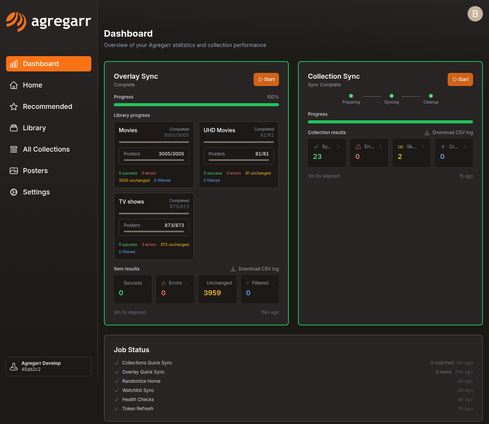

# Agregarr (bitr8 fork)

Already running Agregarr? Swap one line and you're on the fork.

```diff
-    image: agregarr/agregarr:latest
+    image: bitr8/agregarr:latest
```

Run `docker compose up -d` and you're sorted. The fork uses your existing config folder, so your collections, overlays, and settings stay put. You don't need to export, import, or set anything up again.

!!! warning "Still running `agregarr/agregarr`? Switch to this image."
    Upstream's `:latest` (v2.4.2, March 2026) includes `youtube-search-without-api-key`, a package npm pulled and flagged as malicious ([MAL-2026-18270](https://osv.dev/vulnerability/MAL-2026-18270)), and runs on Node 20. Releases from this fork remove that package and include security updates for Node, Express, axios, sharp, and Next.js. See [v2.12.1](https://github.com/bitr8/agregarr-dev/releases/tag/v2.12.1) and [v2.12.3](https://github.com/bitr8/agregarr-dev/releases/tag/v2.12.3).

## What is this fork?

Upstream [Agregarr](https://github.com/agregarr/agregarr) has been quiet since April 2026. I've carried it on from there, adding fixes, new features, and a release every few weeks. The [official Agregarr documentation](https://agregarr.org) still covers installation, basic setup, source types, and the UI. These docs cover the bits added by the fork.

### Which image tag

| Tag | What it tracks |
| --- | --- |
| `:latest` | Stable releases. The one to run. |
| `:2.13.1` (etc.) | Pinned to one release. |
| `:develop` | Builds on every push. For testing, not day-to-day use. |

Starting from scratch? The [README](https://github.com/bitr8/agregarr-dev#docker) has the full Compose example.

## Feature overview



### Collections
- [**Collection Presets**](Collections.md#collection-presets): 12 preset configs, including Trending Movies Today, IMDb Top 250, and Netflix Top 10 Movies
- [**Library Essentials**](Collections.md#library-essentials): automatically builds smart collections by genre, decade, resolution, or content rating
- [**Separator Collections**](Collections.md#separator-collections): visual dividers that organise long collection rows
- [**Label Collections**](Collections.md#label-collections): collections built from Plex labels
- [**Per-User Targeting**](Collections.md#per-user-collection-targeting): limits a collection to one Plex user
- [**Sort Title**](Collections.md#sort-title): controls where a collection sorts
- [**Filtered Hubs**](Collections.md#filtered-hubs): recently added and released hubs that leave out placeholders, including individual episodes
- [**More Sources and Options**](Collections.md#more-sources-and-options): TVDB lists, IMDb Bottom 100, random lists, label exclusion, and more
- [**Export/Import**](Collection-Export-Import.md): moves collection configs between instances

### Overlays
- [**Overlays**](Overlays.md): overlay templates, canvas size, and the sync dashboard
- [**Conditional Elements**](Overlay-Conditions.md): shows or hides individual elements based on media properties
- [**Color Scale**](Color-Scale.md): interpolates tile colours from numeric values, such as an IMDb rating gradient
- [**Maintainerr Countdown**](Maintainerr-Countdown.md): deletion countdown shown on posters
- [**Episode Media Scanning**](Episode-Scanning.md): resolution and HDR badges read from episode files
- [**Template Variables**](Overlay-Variables.md): variables available in overlay templates

### System
- [**Health Checks**](Health-Checks.md): 18 diagnostic checks, with an option to mute the ones you don't need
- [**Integrations**](Integrations.md): Cloudflare solver support for FlareSolverr, Byparr, or Trawl, used with FlixPatrol and other protected sources, plus the other services Agregarr connects to
- [**Settings**](Settings.md): general, Plex, sources, downloads, and jobs settings

### Under the hood
- [**Placeholders**](Placeholders.md): how Agregarr creates and cleans up placeholder items
- [**Performance**](Performance.md): how syncs avoid doing the same work again
- [**Cycle Lists**](Cycle-Lists.md): one row that moves to the next list each time it syncs

## Help improve these docs

Found a mistake or a step that's missing? Every page has an edit button at the top right. See [Contributing](Contributing.md).

## Links

- [Docker Hub](https://hub.docker.com/r/bitr8/agregarr)
- [GitHub (source)](https://github.com/bitr8/agregarr-dev)
- [Issues](https://github.com/bitr8/agregarr-dev/issues)
- [Upstream Agregarr](https://github.com/agregarr/agregarr)
- [Upstream Docs](https://agregarr.org)
