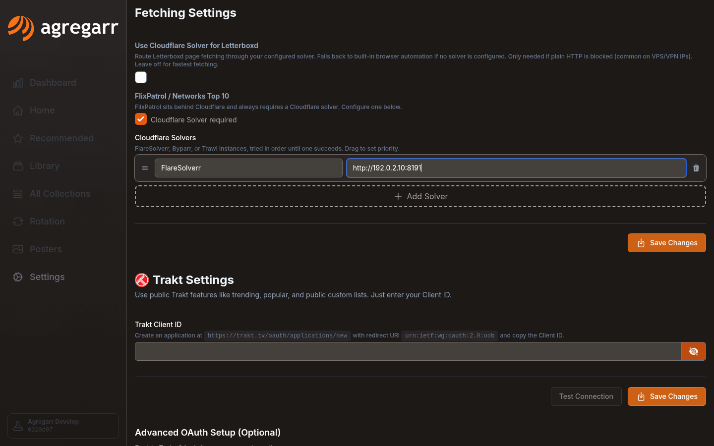
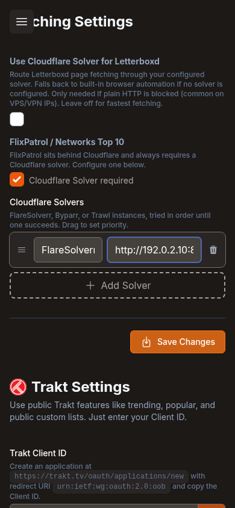

# Cloudflare solvers

Some sites sit behind a Cloudflare challenge, the "checking your browser" wait that plain requests can't pass. A solver runs the page in a real browser and sends the result back to Agregarr. Run one next to Agregarr, then add its address under **Settings > Sources**.

You can add more than one. Agregarr tries them in order.

## What Agregarr uses it for

- **Networks Top 10** collections read FlixPatrol's charts. FlixPatrol sits behind Cloudflare, so these need a solver. Plain HTTP doesn't work for FlixPatrol. See [Networks](../collections/sources/networks.md).
<!-- OPEN: NEW: Settings > Sources says FlixPatrol always requires a Cloudflare solver (SettingsSources.tsx:165-168) but the code falls back to the built-in browser when none is configured (CloudflareSolver.ts:139-143) -->
- **Letterboxd**, but only when you tick **Use Cloudflare Solver for Letterboxd**. Letterboxd normally works over plain HTTP.

IMDb, TMDB and the key-based services don't use solvers. See [Keys](keys.md).

## Requirements

- A solver running somewhere Agregarr can reach over the network. Agregarr supports FlareSolverr, Byparr and Trawl.
- In Docker, the address needs to work from inside the Agregarr container. If both containers share a Docker network, use the solver's service name. Otherwise, use the host's IP address and published port.

The Agregarr image also includes a headless Chromium browser. For Cloudflare-protected pages, Agregarr only uses it when no solver is configured. It doesn't reliably get past FlixPatrol's challenge. IMDb custom lists use it either way (see [Keys](keys.md#imdb-charts-no-key-needed)).

## Run a solver

If you don't have one yet, add FlareSolverr to the same Compose file as Agregarr:

```yaml
services:
  agregarr:
    image: bitr8/agregarr:latest
    # ... your existing config

  flaresolverr:
    image: ghcr.io/flaresolverr/flaresolverr:latest
    container_name: flaresolverr
    environment:
      - LOG_LEVEL=info
    ports:
      - "8191:8191"
    restart: unless-stopped
```

Use `:latest` for Agregarr, or pin a release tag if you'd rather control when it updates. Start the stack again so the solver comes up.

[Byparr](https://github.com/ThePhaseless/Byparr) and [FlareSolverr](https://github.com/FlareSolverr/FlareSolverr) each document their own image and port.

## Set it up

1. Open **Settings > Sources** and find **Fetching Settings** at the top.
2. Under **Cloudflare Solvers**, click **Add Solver**.
3. Enter a name in the first box and the solver's address in the second, for example `http://flaresolverr:8191`.
4. To add a fallback, click **Add Solver** again. Drag a row by its handle to change the order.
5. Click **Save Changes**.

    **Check:** a green toast says **Fetching settings saved successfully!**

6. Open **Settings > About**, find **Health Checks** and click **Run Now**. Saving the solver settings doesn't run the checks.

    **Check:** a toast says **Health checks started.** A few seconds later, **Cloudflare Solver Connection** shows OK and its message reads "1/1 solver reachable".

=== "Desktop"

    

=== "Phone"

    

If you already had a single FlareSolverr address from an older version, Agregarr moves it into this list.

## Options

The **Fetching Settings** box has its own **Save Changes** button. It's separate from the buttons in the boxes below it.

### Use Cloudflare Solver for Letterboxd

Default: off. This sends Letterboxd page requests through your solvers instead of plain HTTP. Turn it on only when Letterboxd blocks Agregarr, which is common on VPS and VPN addresses. Plain HTTP is faster. With no solver configured, Agregarr uses its built-in browser instead.

While it's off, the **Letterboxd Cloudflare** health check warns you when Cloudflare has blocked Letterboxd in the last 8 hours. See [Health Checks](../Health-Checks.md).

### FlixPatrol / Networks Top 10

Always ticked and greyed out, with the label **Cloudflare Solver required**. It's a reminder rather than a setting, so you can't change it.

### Cloudflare Solvers

The ordered list of solvers. Agregarr starts at the top and keeps going until one works. The tip beside it reads: "FlareSolverr, Byparr, or Trawl instances, tried in order until one succeeds. Drag to set priority."

### Name

Default: empty. Use any label you like, for example `FlareSolverr`. Agregarr includes it in log lines and health check messages. If you leave it empty, Agregarr uses the address instead.

### URL

Default: empty. The solver's address, for example `http://flaresolverr:8191`. Agregarr drops a row with no address when you save.

### Add Solver

Adds an empty row at the bottom of the list.

### Drag to reorder

The handle at the left of each row. Drag it to change the order. Agregarr tries solvers higher in the list first.

### Delete solver

The bin icon at the right of each row. It removes the row when you save.

## What Agregarr writes in a solver

Nothing. For each page, Agregarr asks the solver to load an address and return what it finds. It doesn't create or change anything on the site.

## How solvers behave

- **No built-in browser once a solver exists.** Once you've configured at least one solver, Agregarr doesn't fall back to the built-in browser. If every solver is down, the health check reports it.
- **A failing solver is skipped for a while.** The first failure from a solver has no penalty. Agregarr tries it again on the next request. After two failures in a row, Agregarr skips that solver for that site for 1 minute. Each failure after that doubles the wait, up to 16 minutes. If the next failure happens more than 20 minutes after the last wait ended, the count starts again. A successful request also resets it. Agregarr keeps trying your other solvers.
- **Pages are cached for 5 minutes.** Asking for the same page twice in a row sends only one request to the solver.
- **FlixPatrol uses its platform page when the overview has no section.** When FlixPatrol's overview page has no section for a platform, Agregarr reads that platform's own Top 10 page. Peacock and Hulu use FlixPatrol's United States page.
- **Page extras reuse the solver's session.** Agregarr reuses the solver's cookies for 30 minutes when fetching FlixPatrol's style and image files.

## Limits

- **A solver can take a minute.** Agregarr waits up to about 70 seconds for each answer.
- **A solver can load the page and still be refused.** The log says so, for example `solver loaded flixpatrol.com but the site returned HTTP 403`. If every solver fails and at least one was refused, the **Cloudflare Solver** health check stays red for up to 24 hours, or until a later fetch works. Agregarr only checks this when you have a Networks Top 10 collection. Restarting Agregarr clears it. This usually points to Cloudflare challenging your server's IP address. Run the solver through a VPN.
- **There's no Test Connection button.** The health checks are the test. They run every 6 hours and when you click **Run Now**.

## If it didn't work

- **Health Checks show Cloudflare Solver as an error and you have a Networks Top 10 collection.** You haven't added a solver, or every solver was refused in the last 24 hours. Add one, or send the solver through a VPN.
- **Cloudflare Solver Connection reports a solver unreachable.** The address doesn't work from inside the Agregarr container. In Docker, `localhost` points to the Agregarr container itself. Use the solver's service name or the host's IP address.
- **A solver that's busy still counts as reachable.** While it works on a challenge, it can stop answering for a short while. The check reports "busy solving a challenge" rather than failing it.
- **The Networks Top 10 platform list says "Failed to load platforms. Please try again."** Agregarr couldn't read FlixPatrol. Check that the solver is running, then look at the health checks.
- **Letterboxd works in your browser but not in Agregarr.** If the **Letterboxd Cloudflare** health check warns, tick **Use Cloudflare Solver for Letterboxd**.
- **Letterboxd got slower after you ticked it.** The tip beside the option says plain HTTP is the fastest way to fetch. Untick it when Letterboxd isn't blocking you.

## Related

- [Health Checks](../Health-Checks.md#the-cloudflare-solver-check)
- [Networks](../collections/sources/networks.md)
- [Lists](../collections/sources/lists.md)
- [Keys](keys.md)
