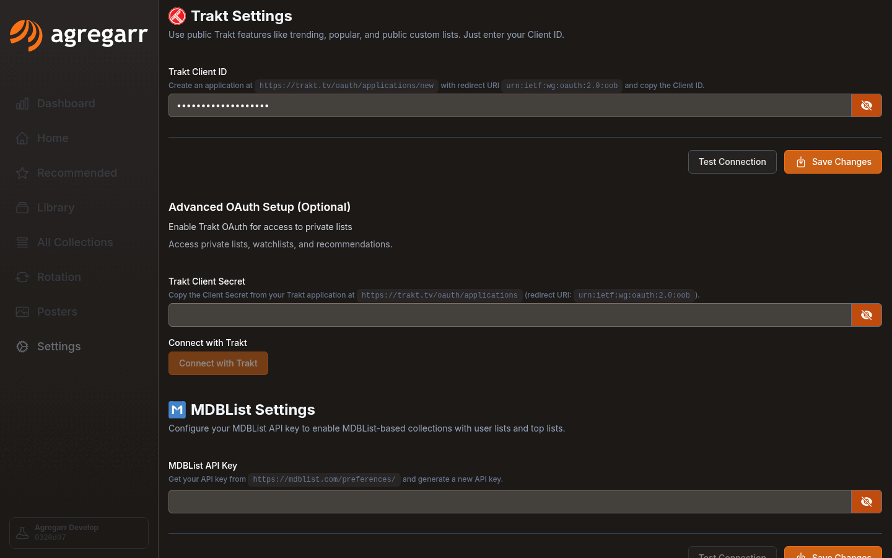
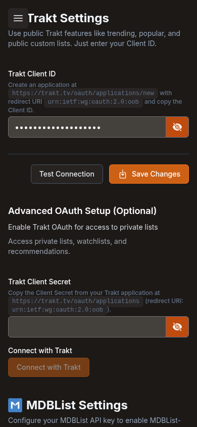
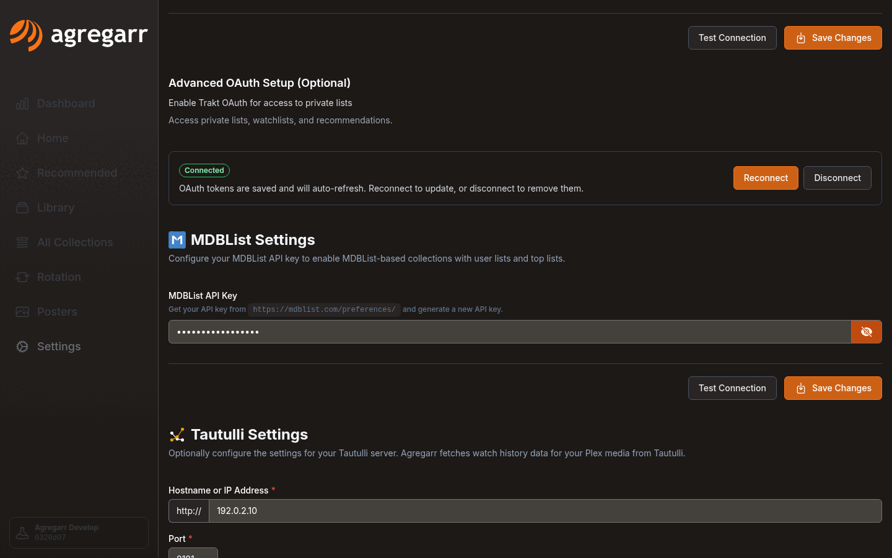
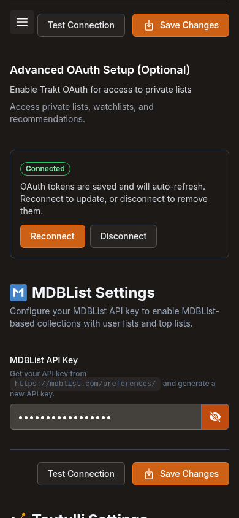
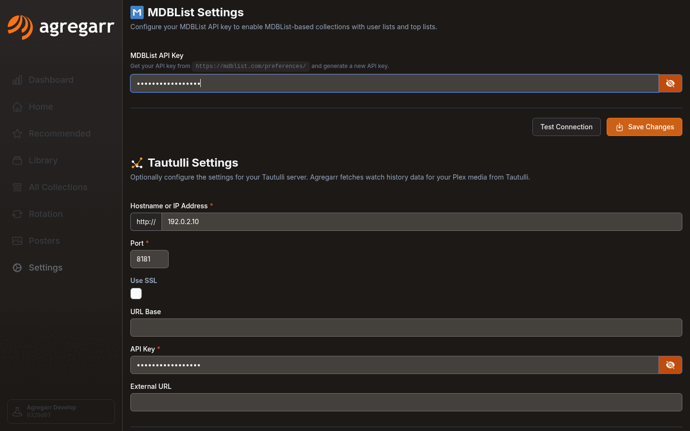
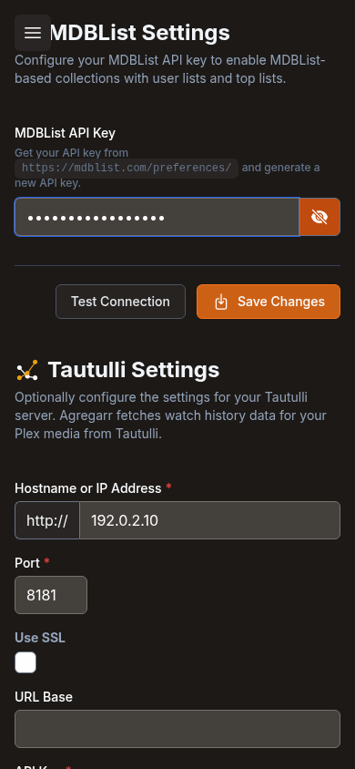
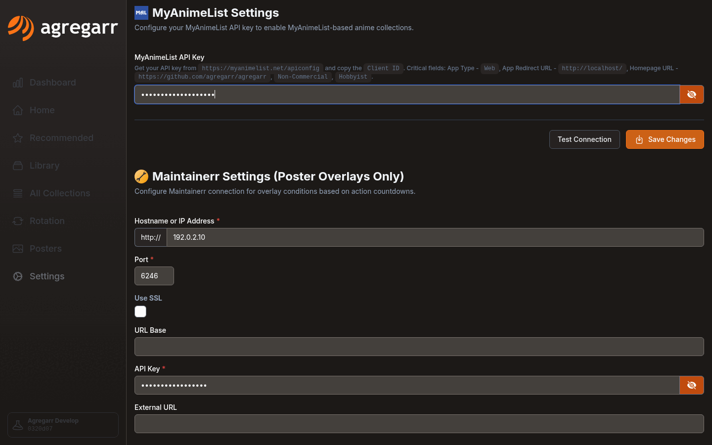
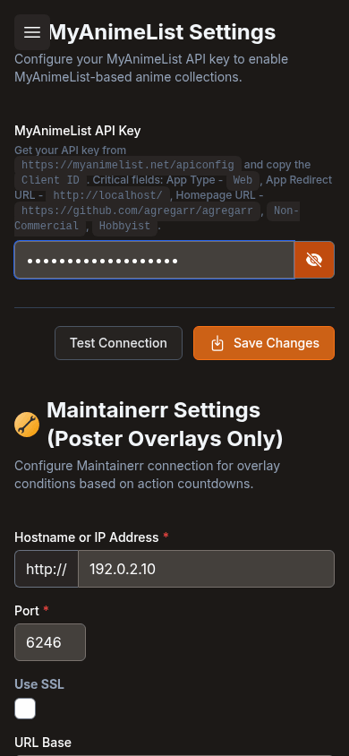

# Trakt, MDBList and MyAnimeList keys

Trakt, MDBList and MyAnimeList need a key before Agregarr can use them. You enter each one under **Settings > Sources**, where every box has a **Test Connection** button.

IMDb, TMDB and Letterboxd don't need a key. The **Sources** page notes this at the top. See [IMDb charts](#imdb-charts-no-key-needed) below for the data Agregarr fetches from IMDb.

During first-run setup, **Save Changes** in each box stays greyed out until **Test Connection** passes with the value you entered. After setup, you can save without testing first. The [setup wizard](../get-started/setup-wizard.md) covers that step.

## Trakt

Trakt provides charts and public lists. Connecting your account also gives Agregarr access to your recommendations and watchlist.

### What Agregarr uses it for

- **Trakt Lists** collections. See [Lists](../collections/sources/lists.md#trakt-lists).
- The **Trakt Anticipated** sub-type of **Coming Soon**. See [Coming Soon](../collections/sources/coming-soon.md).
- Trakt sources inside [Multiple Sources](../collections/sources/multiple-sources.md).
- The Trakt entries under **Start from Preset**. They only appear after you save a **Trakt Client ID**.

### Requirements

- A Trakt account. Trakt limits free accounts to one connected app, and Agregarr shows a notice about this when you choose **Trakt Lists**. If another tool already connects to Trakt, a VIP account avoids the clash.
- Agregarr can reach Trakt's API over the internet.
- For the OAuth block, the Agregarr server owner account. Only that account can finish the connection.

### Get the credentials

1. Sign in to Trakt and create an application at `https://trakt.tv/oauth/applications/new`.
2. Set the redirect URI to `urn:ietf:wg:oauth:2.0:oob`. Enter it exactly as shown.
3. Save the application and copy its **Client ID**.
4. For recommendations, watchlists and private lists, copy the **Client Secret** from `https://trakt.tv/oauth/applications` as well.

### Connect with a Client ID

A Client ID is all you need for charts and public lists.

1. Open **Settings > Sources** and find **Trakt Settings**.
2. Paste the ID into **Trakt Client ID**.
3. Click **Test Connection**.

    **Check:** a green toast says **Connected to Trakt successfully!**

4. Click **Save Changes**.

    **Check:** a green toast says **Trakt settings saved successfully!** On the collection form, **Collection Type** no longer shows an orange **Trakt required.** warning.

=== "Desktop"

    

=== "Phone"

    

### Connect your Trakt account (OAuth)

Do this for the **Recommendations** and **Watchlist** sub-types or to read private lists. Save your Client ID first.

1. Under **Advanced OAuth Setup (Optional)**, paste the application's secret into **Trakt Client Secret**.

    The box stays greyed out, with a **Configure Basic Setup First** warning above it, until you save a Client ID.

2. Click **Connect with Trakt**.

    A Trakt tab opens and an **Enter Trakt Code** window appears in Agregarr. You can also get a red **Unable to start Trakt OAuth flow** toast even though the Trakt tab opened. If the tab opened, ignore the toast and carry on. If it didn't, allow pop-ups for Agregarr and try again.
<!-- OPEN: NEW: window.open is called with 'noopener,noreferrer' (SettingsSources.tsx:947-951); the HTML spec returns null whenever noopener is set, so the !opened toast at :952-957 fires on every successful open. Class: code bug. LIVE? confirm in Chrome and Firefox -->

3. Approve access in the Trakt tab. Trakt shows a short code. Copy it.
4. Paste the code into **Enter Trakt Code**, then click **Exchange Code**. You can paste the full address Trakt gives you instead. Agregarr pulls the code from it.

    **Check:** a green toast says **Trakt authorized successfully!** The OAuth block shows a green **Connected** badge and the line "OAuth tokens are saved and will auto-refresh. Reconnect to update, or disconnect to remove them."

=== "Desktop"

    

=== "Phone"

    

### Options

#### Trakt Client ID

Default: empty. The Client ID from your Trakt application. The box hides the value. Charts and public lists only need this field.

#### Test Connection (Trakt)

Greyed out while **Trakt Client ID** is empty. With only a Client ID, it asks Trakt for the top trending movie. After you connect through OAuth, it checks your account instead. It tests the value in the box without saving it.

#### Trakt Client Secret

Default: empty. The secret from the same Trakt application. The box hides the value. You only need it for the OAuth connection. There is no separate save step: **Exchange Code** saves it with the tokens.

#### Connect with Trakt

Starts the sign-in described above. It's greyed out until you save a Client ID and enter a secret in the box.

#### Enter Trakt Code

The window where you paste Trakt's code. **Exchange Code** stays greyed out until the box contains a value. **Cancel** closes the window without connecting.

#### Reconnect

Shown instead of **Connect with Trakt** after you connect. It repeats the same sign-in, for example after you regenerate the secret on Trakt.

#### Disconnect

Removes the saved tokens. The Client ID and Client Secret stay saved, so you can click **Connect with Trakt** again without entering them again. Collections that need OAuth fail to sync until you reconnect.

### What Agregarr writes in Trakt

Nothing. Agregarr reads charts, lists, recommendations and your watchlist if you connect your account. It doesn't add to lists, rate titles or mark anything watched. The only other call it sends to Trakt renews your access token.

### Limits

- **Tokens renew themselves.** Agregarr refreshes the access token one minute before it expires and saves the replacement. Click **Reconnect** if token renewal stops working.
- **Recommendations returns 100 titles** and follows your library's type, either movies or shows.
- **Only the server owner can connect.** Another admin who clicks **Exchange Code** gets the generic **Unable to start Trakt OAuth flow** toast.
<!-- OPEN: NEW: Trakt token refresh sends redirect_uri built from Application URL (or the request host during Test Connection) while the code exchange always sends urn:ietf:wg:oauth:2.0:oob (traktAuth.ts:9-22, trakt-oauth.ts:34, trakt.ts:206-216) -->

### If it didn't work

- **The collection form shows "Trakt required."** No Client ID is saved. For **Recommendations** or **Watchlist**, the warning reads "Trakt (OAuth required for Recommendations) required." (or "...Watchlist..."). Connect your account using the steps above.
- **A sync says "Trakt access token is required".** **Recommendations** or **Watchlist** is selected, but Agregarr isn't connected. The same error appears after you click **Disconnect**.
- **The test says "Invalid client credentials or access token - Authentication failed".** The Client ID is wrong or Trakt has revoked the saved token. Check the ID or click **Reconnect**.
- **The test says "Rate limit exceeded - Try again later".** Trakt has asked Agregarr to slow down. Wait a few minutes before testing again.
- **The Client Secret box is greyed out.** Save a Client ID first.
- **Exchange Code fails.** The code is wrong or expired, or you're signed in to Agregarr with an account other than the server owner. Click **Connect with Trakt** again to get a fresh code.

## MDBList

MDBList publishes curated lists. Agregarr reads them through MDBList's API, which requires your key.

### What Agregarr uses it for

- **MDBList Lists** collections. See [Lists](../collections/sources/lists.md#mdblist-lists).
- **Networks Originals** collections, which use MDBList lists of productions from a streaming service. See [Networks](../collections/sources/networks.md).
- MDBList sources inside [Multiple Sources](../collections/sources/multiple-sources.md).

### Requirements

- An MDBList account.
- Agregarr can reach MDBList's API over the internet.

### Get the credentials

1. Sign in to MDBList and open `https://mdblist.com/preferences/`.
2. Generate a new API key and copy it.

### Connect

1. Open **Settings > Sources** and find **MDBList Settings**.
2. Paste the key into **MDBList API Key**.
3. Click **Test Connection**.

    **Check:** a green toast says **Connected to MDBList successfully!**

4. Click **Save Changes**.

    **Check:** a green toast says **MDBList settings saved successfully!** The orange **MDBList required.** warning no longer appears on the collection form.

=== "Desktop"

    

=== "Phone"

    

### Options

#### MDBList API Key

Default: empty. The key from your MDBList preferences page. The box hides the value. **Test Connection** stays greyed out until the box contains a value. It tests that value without saving it. The same key works for MDBList Lists and Networks Originals.

### What Agregarr writes in MDBList

Nothing. Agregarr only reads lists.

### Limits

- MDBList counts requests against your account. Its API reports the request allowance and running count for each key, so a large number of MDBList collections can use up the allowance.
- Agregarr asks MDBList for up to 9,999 entries from a list in one request.

### If it didn't work

- **"MDBList required." under Collection Type.** No key is saved. For **Networks Originals**, the warning reads "MDBList (Originals use MDBList lists) required."
- **The test message mentions "Invalid API key or authentication failed".** MDBList rejected the key. Copy it again from the preferences page.
- **The test message mentions "Rate limit exceeded".** MDBList has asked Agregarr to slow down. Try again later.
- **A sync says "MDBList API key not configured (required for Originals collections)".** Save a key, then run the sync again.

## MyAnimeList

MyAnimeList provides its top anime charts.

### What Agregarr uses it for

- **MyAnimeList** collections. See [Anime](../collections/sources/anime.md#myanimelist).
- MyAnimeList sources inside [Multiple Sources](../collections/sources/multiple-sources.md).

### Requirements

- A MyAnimeList account.
- Agregarr can reach MyAnimeList's API over the internet.

### Get the credentials

1. Sign in to MyAnimeList and open `https://myanimelist.net/apiconfig`. Create an application.
2. Use the settings listed in the tip under the field: **App Type** `Web`, **App Redirect URL** `http://localhost/`, **Non-Commercial** and **Hobbyist**. Use the **Homepage URL** from the tip.
3. Save the application and copy the **Client ID**. You don't need the Client Secret.

### Connect

1. Open **Settings > Sources** and find **MyAnimeList Settings**.
2. Paste the Client ID into **MyAnimeList API Key**. The label says API Key, but this box takes the Client ID.
    <!-- OPEN: M7 -->
3. Click **Test Connection**.

    **Check:** a green toast says **Connected to MyAnimeList successfully!**

4. Click **Save Changes**.

    **Check:** a green toast says **MyAnimeList settings saved successfully!** The orange **MyAnimeList required.** warning no longer appears on the collection form.

=== "Desktop"

    

=== "Phone"

    

### Options

#### MyAnimeList API Key

Default: empty. Your application's Client ID. The box hides the value. **Test Connection** stays greyed out until the box contains a value. It asks MyAnimeList for five of the top-ranked anime using that value, without saving it.

### What Agregarr writes in MyAnimeList

Nothing. Agregarr only reads the ranking charts and doesn't touch your anime list.

### Limits

- Agregarr asks MyAnimeList for 500 entries at a time, with up to 20 requests per chart. It stops early after enough results match your library. See [Anime](../collections/sources/anime.md#myanimelist).

### If it didn't work

- **"MyAnimeList required." under Collection Type.** No Client ID is saved.
- **The test says "Invalid API key - Authentication failed".** MyAnimeList rejected the Client ID. Copy it again from the API page and check that you didn't paste the Client Secret.
- **The test says "Rate limit exceeded - Try again later".** MyAnimeList has asked Agregarr to slow down. Try again later.

## IMDb charts (no key needed)

The IMDb **Top 250**, **Top 250 English**, **Bottom 100**, **Popular (Meter)** and **Box Office** collections read IMDb's public chart data. You don't need to enter a key or run a solver.

- Agregarr rejects a chart when it contains fewer items than IMDb says it should. The sync stops with an error instead of building a short list. **Box Office** is the exception because IMDb's weekend chart only contains ten titles.
- Custom IMDb lists and watchlists use a different path. Agregarr opens them in its built-in browser rather than using your [Cloudflare solvers](cloudflare-solvers.md), so the first request can take a while. See [Lists](../collections/sources/lists.md#imdb-lists).

## Related

- [Tautulli and Tracearr](tautulli-tracearr.md)
- [Cloudflare solvers](cloudflare-solvers.md)
- [Lists](../collections/sources/lists.md)
- [Anime](../collections/sources/anime.md)
- [Choose a source](../collections/choose-a-source.md)
