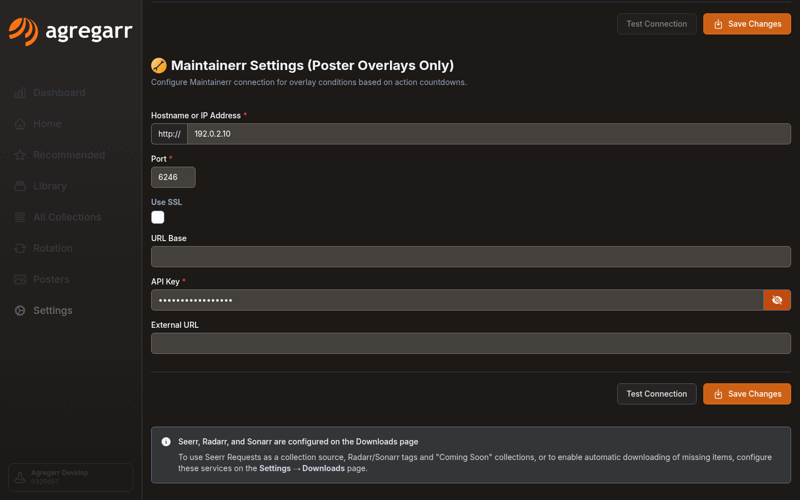
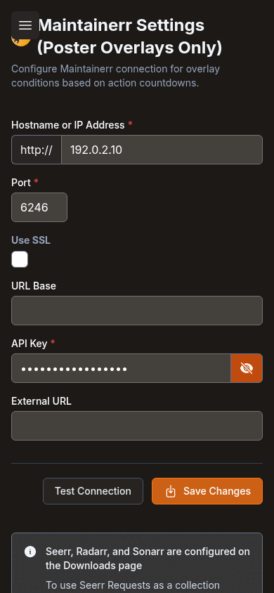

# Maintainerr

Maintainerr decides which titles leave your library and when. Agregarr reads that schedule so poster overlays can count down to the day an item is removed.

## What Agregarr uses Maintainerr for

Agregarr uses Maintainerr for one thing: the leaving-soon countdown on poster overlays. Each time an overlay job runs, Agregarr asks Maintainerr for its collections. For every item in those collections, it works out how many days remain before Maintainerr acts and passes that number to your overlay templates as **Days Until Maintainerr Action**.

That is the whole connection. The section is labelled **Maintainerr Settings (Poster Overlays Only)** for that reason. Agregarr doesn't use Maintainerr to build collections, request media or delete anything.

The countdown rules, including which date wins and how season and show posters behave, are covered in [Maintainerr Countdown](../Maintainerr-Countdown.md). This page covers the connection.

## Requirements

- Maintainerr running and reachable from the Agregarr container. If both run in Docker on the same custom network, use Maintainerr's container name as the host. Otherwise, use the address of the machine running it, for example `192.0.2.10`.
- Maintainerr's API key.
- Maintainerr 3.4.0 or later for season countdowns. Movie and show countdowns work on older versions.

## Get the credentials

1. Open Maintainerr in your browser.
2. Open its settings and copy the API key.

## Connect

1. Go to **Settings > Sources** and scroll to **Maintainerr Settings (Poster Overlays Only)**.
2. Fill in **Hostname or IP Address**, **Port** and **API Key**. **Test Connection** becomes available once the three fields marked with an asterisk are filled in.
3. Click **Test Connection**.

    **Check:** a green message reads **Connected to Maintainerr successfully!**

4. Click **Save Changes**.

=== "Desktop"

    

=== "Phone"

    

In the setup wizard's **Configure Sources** step, entering an **API Key** keeps **Save Changes** greyed out until **Test Connection** passes with the same values. Leave the key empty to skip Maintainerr.

To use the countdown, turn on the **Maintainerr Deleting Soon** preset or use a template containing **Days Until Maintainerr Action**. [Maintainerr Countdown](../Maintainerr-Countdown.md#setup) has the steps.

## Options

### Hostname or IP Address

Required. No default. The name or address Agregarr uses to reach Maintainerr from inside its container. Enter only the host, with no `http://` and no port.

### Port

Required. Default: `6246`.

### Use SSL

Default: off. Turn it on when Maintainerr answers on `https`.

### URL Base

Default: empty. Fill it in only when Maintainerr is behind a reverse proxy under a path, for example `/maintainerr`. It needs a leading slash and no trailing slash.

### API Key

Required. No default. Agregarr sends it with every request to Maintainerr.

### External URL

Default: empty. The address you use to open Maintainerr in a browser. It must be a full URL with no trailing slash.
<!-- OPEN: NEW: Maintainerr External URL is saved but nothing in the code reads it -->

### Test Connection

Asks Maintainerr for its collection list using the values in the form, whether they're saved or not. It needs **Hostname or IP Address**, **Port** and **API Key**.

## What Agregarr writes in Maintainerr

Nothing. Agregarr only reads from Maintainerr. It never creates, edits or removes a Maintainerr collection or rule. It also never tells Maintainerr to delete anything. Maintainerr stays in charge of what leaves your library.

## Limits

- Agregarr reads Maintainerr's data once per overlay job, not live. Changes in Maintainerr appear on posters after the next overlay job covering that item.
- A collection only counts when its delete-after days is above zero.
- Season countdowns need Maintainerr 3.4.0 or later. Agregarr ignores season collections on older versions.
- If Agregarr can't reach Maintainerr during an overlay job, it skips the season pass and restores nothing. [Maintainerr Countdown](../Maintainerr-Countdown.md#safety) explains what that protects.

## If it didn't work

**Test Connection says "Invalid API key - Authentication failed".** Maintainerr answered but refused the key. Copy it again from Maintainerr's settings.

**It says "Maintainerr API not found - Check URL base and port".** Something answered at that address, but it wasn't Maintainerr's API. Check **Port** and **URL Base**.

**It says "Connection refused", "Host not found" or "Connection timeout".** Agregarr can't reach that address from inside its container. `localhost` means the Agregarr container itself. Use Maintainerr's container name on a shared network or the machine's address instead.

**The connection tests fine but posters show no countdown.** Check [Maintainerr Countdown](../Maintainerr-Countdown.md#the-countdown). The item needs a Maintainerr collection with a delete-after setting above zero and the overlay needs a template that reads **Days Until Maintainerr Action**.

**A health check reports Maintainerr as down.** The **Maintainerr Connection** check asks Maintainerr for its collections and waits 5 seconds for an answer. It runs with the Health Checks job every 6 hours by default. The check is skipped when no hostname and API key are saved. See [Health Checks](../Health-Checks.md#the-checks).

## Related

- [Maintainerr Countdown](../Maintainerr-Countdown.md)
- [Overlay Variables](../Overlay-Variables.md#other-variables)
- [Health Checks](../Health-Checks.md#the-checks)
- [Settings](../Settings.md#sources)
