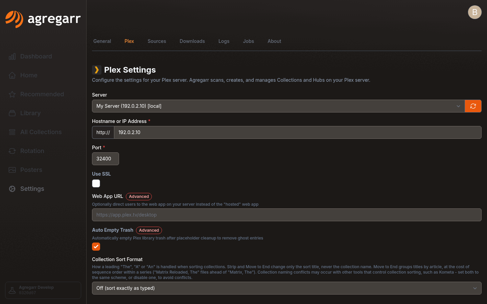
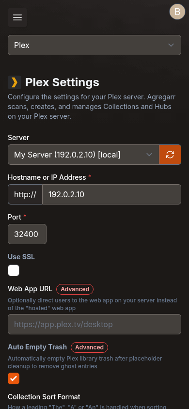

# Plex

Agregarr needs Plex to work. It reads your movie and TV libraries, then builds collections, labels, sort titles and posters on the server. This page covers **Settings > Plex**, the libraries Agregarr can see and what it writes to your server.

The setup wizard uses the same form in step 2. If you've finished the wizard, come back here when you need to change the connection.

## Requirements

- A Plex Media Server that Agregarr can reach over the network. The Agregarr container needs access to the server's address and port. `localhost` inside the container points to the container itself, so use the server's IP address (for example `192.0.2.10`) or a name your network resolves.
- The Plex account that owns the server. The first account to sign in to Agregarr becomes the admin. Agregarr uses that account's Plex sign-in for every call to your server.
- At least one movie or TV library. Agregarr doesn't list other library types.

## Get the credentials

There's no key to copy. Agregarr stores the Plex sign-in it receives when you click **Sign In** in the wizard.

1. Open Agregarr and sign in with the Plex account that owns your server. See [First run: the setup wizard](../get-started/setup-wizard.md).
2. Note your server's address and port as Agregarr sees them, for example `192.0.2.10` and `32400`.

## Connect

1. Go to **Settings > Plex**.
2. Click the round arrow next to **Server**. Agregarr asks plex.tv for the servers your account owns, then tests each available route.

    **Check:** a toast says "Plex server list retrieved successfully!" and the **Server** dropdown is no longer greyed out. Each line reads like `My Server (192.0.2.10) [local]`, with `[remote]` or `[secure]` where those apply. A line Agregarr can't reach is greyed out and ends with the reason.

3. Choose your server from the dropdown. Agregarr fills in **Hostname or IP Address**, **Port** and **Use SSL**. You can skip the dropdown and enter those three fields yourself.
4. Click **Save Changes**.

    **Check:** a toast says "Plex connection established successfully!". If a red toast says "Failed to connect to Plex.", nothing is saved. See [If it didn't work](#if-it-didnt-work).

=== "Desktop"

    

=== "Phone"

    

Agregarr tests the connection before saving it. Only a working connection is stored. It also records the server's name and unique machine ID, runs its health checks and reads your libraries again.

## Options

The fields appear in this order.

### Server

Default: none. This dropdown gets its list from plex.tv. It only shows servers owned by the admin's Plex account, with one line for each way Agregarr can reach a server. Reachable lines appear first, with secure ones ahead of plain ones.

The dropdown starts greyed out and reads "Press the button to load available servers". Click the round arrow to fill it. Choosing a line only fills in the three fields below. Agregarr doesn't save the dropdown choice itself.

### Hostname or IP Address

Required. The address of your Plex server from Agregarr's point of view. The grey `http://` or `https://` before the box follows **Use SSL**. Enter only the host name or IP address. Don't include `http://`, a port or a path.

### Port

Required. Default: `32400`. Change it only if Plex uses another port.

### Use SSL

Default: off. Tick it when Agregarr reaches Plex over `https`. Choosing a `[secure]` line from the dropdown ticks it for you.

### Web App URL

Advanced. Optional. Default: empty, which means `https://app.plex.tv/desktop`. Agregarr saves this address, but nothing in Agregarr currently shows a link built from it. Changing it has no visible effect. Enter a full URL.
<!-- OPEN: NEW: Web App URL is saved and used by Media.setPlexUrls, but nothing in the UI or API consumes plexUrl, so the field has no visible effect -->

### Auto Empty Trash

Advanced. Default: on. This applies only to placeholders. After removing placeholder entries, Agregarr can empty the whole library's Plex trash as the last step. That also removes anything else already sitting in the trash.

Turn it off if you don't want Agregarr emptying a trash. If you don't use placeholders, the setting does nothing. See [Placeholders](../Placeholders.md#direct-plex-deletion) for when placeholders are removed.
<!-- OPEN: in flux: placeholder cleanup timing and the exact Auto Empty Trash conditions -->

### Collection Sort Format

Default: **Off (sort exactly as typed)**. This controls how Plex handles a leading "The", "A" or "An" when sorting collections. It only changes the sort title. The collection's name stays the same.

- **Strip (e.g. "The Accountant" → "Accountant")**: sorts as "Accountant".
- **Move to End (e.g. "The Accountant" → "Accountant, The")**: sorts as "Accountant, The". This groups titles by article but splits a series: "Matrix Reloaded, The" sorts before "Matrix, The".
- **Off (sort exactly as typed)**: the sort title is the name.

Strip and Move to End also remove leading punctuation, matching Plex's behaviour.

The setting applies to collections in the A-Z section of **Library**. Promoted collections use their numbered `!001_` prefix instead. A **Sort Title** you set yourself takes precedence. Switching back to **Off** restores the plain name on collections Agregarr changed earlier.

If Kometa or another tool also sets collection sort titles, use the same scheme in both or turn one off. Otherwise, the tools overwrite each other's values. You can also add the other tool's Plex label to **Exclude from Ordering (Plex Label)** on **Settings > General**. Agregarr then leaves the order, visibility and sort title alone for matching collections it didn't create. See [Promote collections above the A-Z list](../appear/promote-library.md) and [Sort Title](../collections/name-collections.md#sort-title).

### Save Changes

Tests the connection, saves the fields and reads your libraries again. It's greyed out while a field has an error, such as an empty **Hostname or IP Address**.

## Your libraries

**Settings > Plex** doesn't show a library list. Agregarr keeps the list in the background and displays it wherever you choose a library, such as **Library Selection** in the Add Collection form.

- Only movie and TV libraries appear. Music and photo libraries don't, and neither do libraries configured without a metadata agent.
- Agregarr reads the list again when you click **Save Changes**, run **Discover Existing Collections & Hubs** or open a page that lists libraries, such as **Home**, **Recommended** or **Library**.
- Each read replaces the existing list. A library added in Plex appears after the next read. A library deleted or renamed in Plex appears as removed or new.

## One Agregarr for each Plex server

One Agregarr install connects to one Plex server. Collections, hubs and library settings are stored against that server.

To manage a second server, run another Agregarr instance with its own config folder and port. See [Install with Docker Compose](../get-started/install-docker.md).

## What Agregarr writes in Plex

Agregarr changes your server when a sync runs, not when you click **Create Collection**. It writes the following:

- **Collections.** It creates and updates regular collections, smart collections and filtered hubs. It adds or removes titles to match the source and sets each collection's title.
- **Labels on collections.** Agregarr adds a Plex label starting with `Agregarr` to the collections it creates. It uses the label to recognise its own collections, so leave it in place.
- **Labels on titles.** A title that drops out of a collection gets the `agregarr-stale` label. Agregarr removes the label when the title returns. A collection with **Filter to Unwatched Items Only** adds an `agregarr-unwatched-` label to its titles. Placeholders carry `trailer-placeholder`. See [Placeholders](../Placeholders.md#labels-and-hubs).
- **Sort titles.** Collections in the A-Z section get a sort title based on **Collection Sort Format**. Promoted collections get a numbered sort title such as `!003_Trending Today`. See [Name collections](../collections/name-collections.md).
- **Where rows appear.** Agregarr controls whether a collection or hub appears on your Home, on other people's Home or on the library's Recommended tab. It also controls the order. **Discover Existing Collections & Hubs** does this too. See [Visibility and time restrictions](../collections/form/visibility.md) and [Where collections appear](../appear/index.md).
- **Artwork.** Agregarr uploads collection posters. When configured, it also uploads wallpapers, summaries and theme music. Overlays upload a new poster to each title they badge. See [Posters, wallpapers and theme music](../collections/posters.md) and [Overlays](../Overlays.md).
- **Other people's restrictions.** Per-user collections add a label exclusion to each shared user's movie and TV restrictions. See [Activity sources](../collections/sources/activity.md#seerr-requests).

**Settings > General** has a **Reset Collections** button that removes every Agregarr collection from Plex and clears all user labels.

Agregarr only lists movie and TV libraries, so it doesn't write to your music or photo libraries.

## The Plex webhook

**Settings > Downloads** has a **Plex Webhook** section. It's covered separately.
<!-- OPEN: in flux: Plex webhook URL, token and behaviour, documented once that work lands -->

## Limits

- One Plex server for each Agregarr install.
- Movie and TV libraries only.
- Agregarr calls Plex using the admin account. If that account loses access to the server, every sync fails until it regains access and signs in to Agregarr again. Signing in refreshes the stored Plex sign-in. Using a different account doesn't help because Agregarr always uses the first admin's sign-in.
- **Settings** is meant for the admin only.
<!-- OPEN: M1: any signed-in Plex user can reach the settings API; the pages are admin-only, the routes are not -->

## If it didn't work

- **A red toast says "Failed to connect to Plex."** Nothing was saved. Agregarr couldn't reach the address or Plex refused the admin's sign-in. Check that **Hostname or IP Address** isn't `localhost` when Agregarr runs in Docker, that **Port** is correct and that **Use SSL** matches how Plex serves that address. The reason is in **Settings > Logs**. Look for "Failed to connect to Plex with candidate settings".
- **The Server dropdown is empty.** The list only contains servers owned by the admin's Plex account. If you signed in with a different account, the list stays empty. Enter the address by hand.
- **A red toast says "Failed to retrieve Plex server list."** Agregarr couldn't retrieve the list from plex.tv. Enter the address by hand.
- **A line in the dropdown is greyed out.** Agregarr tested that route and couldn't connect. The text at the end of the line gives the reason. Pick another line.
- **A library is missing.** It isn't a movie or TV library, or it has no metadata agent. A recently added library appears after you open **Home** or run **Discover Existing Collections & Hubs**.
- **Collections sort the same after changing Collection Sort Format.** Plex receives the new sort titles during the next sync. Promoted collections ignore the setting.
- **The success toast appeared but no libraries show.** The toast appears before Agregarr finishes reading the libraries. Open **Home** to read them again.
<!-- OPEN: NEW: SettingsPlex.tsx:276 calls syncLibraries without awaiting it, so a failed library read after a good connection test is silent -->

## Related

- [Connect services](index.md)
- [First run: the setup wizard](../get-started/setup-wizard.md)
- [Finding your way around](../get-started/finding-your-way.md)
- [Where collections appear](../appear/index.md)
- [Reverse proxy, API key and debugging export](reverse-proxy-api.md)
