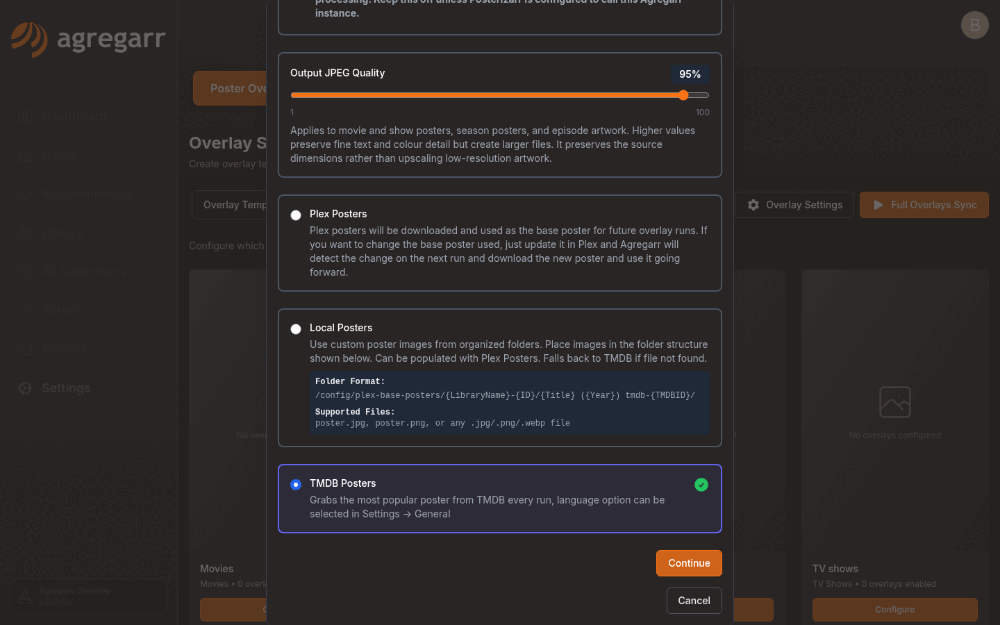
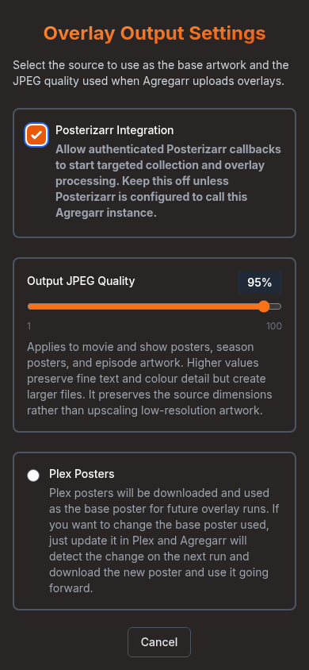

# Posterizarr

Posterizarr can tell Agregarr when it finishes an item. Agregarr then refreshes that item's collections and overlays straight away. This page covers Agregarr's side of the link.

## What Agregarr uses Posterizarr for

Agregarr doesn't connect to Posterizarr. The link runs the other way. With **Posterizarr Integration** on, Agregarr accepts a call from Posterizarr, or any script that signs in the same way, naming one Plex item. It then:

1. Runs a **targeted Collections Quick Sync** for that item, checking which of your collections it belongs to.
2. Redraws the item's overlays within the library's **Quick sync** scope.

Nothing else gets synced. Full collection syncs and full overlay passes keep their own schedules.

## What changes when it's on

The toggle does more than allow callbacks. It also changes how Agregarr saves posters.

| | Posterizarr Integration off | Posterizarr Integration on |
|---|---|---|
| Overlay file format | WebP at a fixed quality | JPEG |
| **Output JPEG Quality** | Has no effect | Sets the JPEG quality |
| Posterizarr calls | Refused with a 403 | Accepted |
| A full **Plex Collections Sync** | Runs as normal | Skips its run while callbacks are running or waiting |
| Season IMDb ratings outside a full overlay pass | Not looked up | Looked up for season templates that use an IMDb rating (quick sync and callbacks) |

<!-- OPEN: M5 Output JPEG Quality only applies with Posterizarr Integration on; the window doesn't say so -->

Agregarr marks each JPEG it draws with a short note in the file ("overlay applied by Agregarr"). Posterizarr uses that marker to identify the poster as Agregarr's. WebP overlays don't carry a marker.

Changing the toggle also changes the fingerprint Agregarr stores for every overlaid item. The next full overlay pass redraws every item after you turn it on or off. Changing **Output JPEG Quality** while the integration is on does the same. For a large library, make either change at a quiet time.

If you don't use Posterizarr, leave the toggle off. The rest of your overlay setup stays the same.

## Requirements

- Posterizarr (or your own script) can reach Agregarr over the network, for example `http://YOUR_SERVER:7171`.
- The library has an overlay enabled, with the artwork you want redrawn ticked in the **Quick sync** column.
- Your Agregarr API key, sent as an `X-API-Key` header.

## Get the credentials

1. Go to **Settings > General**.
2. Copy the **API Key**.

Treat it like a password. It signs in as the first admin account.

## Connect

1. Open **Posters** in the sidebar and choose **Poster Overlays**, then **Library Configuration**.
2. Click **Overlay Settings**. The **Overlay Output Settings** window opens.
3. Tick **Posterizarr Integration**.
4. Set **Output JPEG Quality** if you want something other than the default.
5. Click **Continue**.

    **Check:** the window shows **Settings saved successfully** and closes.

=== "Desktop"

    

=== "Phone"

    

6. On a library card, click **Configure**. The **Configure Overlays** window opens. Scroll to **Sync scope**.
7. In the **Quick sync** column, tick the artwork that Posterizarr callbacks should redraw. Movie libraries have one row, **Movie posters**. TV libraries have **Show posters**, **Season posters** and **Episode cards**.
8. Click **Save Configuration**.
9. Send a `GET` to `/api/v1/posterizarr/status` with your `X-API-Key` header.

    **Check:** the answer is a 200 containing `running`, `queued` and `lastResult`. With the toggle off, the same call returns a 403.

A ticked artwork row also needs an enabled overlay template for that artwork. Without one, the callback skips it. The window lists any gaps under the table.

## Options

### Posterizarr Integration

Default: off. Allows Posterizarr callbacks and switches overlay output from WebP to JPEG.

### Output JPEG Quality

Default: 95. A slider from 1 to 100. Higher values keep more fine text and colour detail but make larger files. It applies to movie and show posters, season posters and episode artwork. Agregarr only uses it while **Posterizarr Integration** is on.

### Quick sync (Sync scope)

Default: the main poster only. Selects which artwork a callback redraws for that library. A movie library only uses its main poster. A callback naming a season or episode redraws it only when **Season posters** or **Episode cards** is ticked.

## The callback

Send a `POST` to `/api/v1/posterizarr/trigger` with a JSON body:

```
curl -X POST "http://YOUR_SERVER:7171/api/v1/posterizarr/trigger" \
  -H "X-API-Key: your API key" \
  -H "Content-Type: application/json" \
  -d '{"ratingKey": "12345", "mediaType": "show", "seasonNumber": 1, "episodeNumber": 3}'
```

| Field | Needed | Meaning |
|-------|--------|---------|
| `ratingKey` | Yes | The Plex rating key of the movie or show, as text of digits. A season or episode key fails. |
| `title` | No | Text used in logs. |
| `mediaType` | No | `movie` or `show`. Required when you send a season or episode. |
| `seasonNumber` | No | Whole number, 0 or more. Shows only. |
| `episodeNumber` | No | Whole number, 1 or more. Needs `seasonNumber`. Shows only. |

For an episode, send the show's rating key with the season and episode numbers. Agregarr finds the season and episode in Plex.

### What the answer means

**202.** Accepted. The body says whether the item was queued or was already queued, running or finished in the last 60 seconds. In those cases, Agregarr skips it. The work happens after Agregarr answers, so a 202 doesn't mean the poster has changed yet.

**400.** The body is wrong, such as a `ratingKey` that isn't a plain positive number or a `seasonNumber` on a movie. The error text names the field.

**403.** **Posterizarr Integration** is off (the error says "Posterizarr integration is disabled in Agregarr settings") or the call didn't sign in (the error says "Authentication required").

**409.** A full collection sync or full overlay pass is running or waiting. The answer carries `Retry-After: 30`. Send the call again afterwards.

**429.** The queue already holds 100 items. The answer carries `Retry-After: 15`.

Calls for different items run one at a time in the order they arrive.

### Checking the queue

A `GET` to `/api/v1/posterizarr/status` returns whether a callback is running, what's waiting and the result of the last one (`completed` or `failed`, with the error text). It returns a 403 while the integration is off.

## What Agregarr writes in Posterizarr

Nothing. Agregarr never calls Posterizarr.

Inside Plex and Agregarr, a callback runs Collections Quick Sync and Overlay Quick Sync for one item. It updates that item's collections, runs the same placeholder tidy-up for it (see [Placeholders](../Placeholders.md)) and uploads a redrawn poster when an overlay applies.
<!-- OPEN: in flux placeholder cleanup timing is being changed elsewhere -->

## Limits

- Movies and shows only. A callback naming a season or episode key as `ratingKey` is accepted with a 202, then fails and appears as `failed` in the status.
- A callback only redraws overlays when the library has an enabled overlay and a non-empty **Quick sync** scope. Otherwise, only the collection part runs.
- Posterizarr callbacks and a full **Plex Collections Sync** don't overlap. If the sync starts first, callbacks get a 409. If callbacks are already running or waiting, the sync run is skipped. Start it again by hand or wait for the next scheduled run.
- A queued callback waits for any running Plex Collections Sync, Collections Quick Sync or overlay run on that library. After 15 minutes, it fails and the status shows `failed` with "Timed out waiting for another collection/overlay job".
- The queue holds 100 items. Agregarr forgets the queue on restart.

## If it didn't work

**The call returns 403.** Check the message. "Posterizarr integration is disabled in Agregarr settings" means the toggle is off or didn't save. "Authentication required" means the `X-API-Key` header is missing or wrong.

**The call returns 202 but the poster didn't change.** Check the status call. A `failed` result gives the reason. If it says `completed`, check that the library has an enabled overlay and the artwork is ticked in **Quick sync**.

**Every call returns 409.** A full sync is running. Wait for it to finish or check the **Plex Collections Sync** and **Poster Overlay Application** rows under **Settings > Jobs**.

**All overlays redrew after I switched the toggle.** That's expected. See [What changes when it's on](#what-changes-when-its-on).

**A Plex Collections Sync run was skipped.** Posterizarr callbacks were running or waiting when it started. Start it again by hand or wait for the next scheduled run.

## Related

- [Overlays](../Overlays.md)
- [Overlay Examples](../Overlay-Examples.md#episode-code-on-episode-cards)
- [Your first overlay](../get-started/first-overlay.md)
- [Settings](../Settings.md#jobs)
