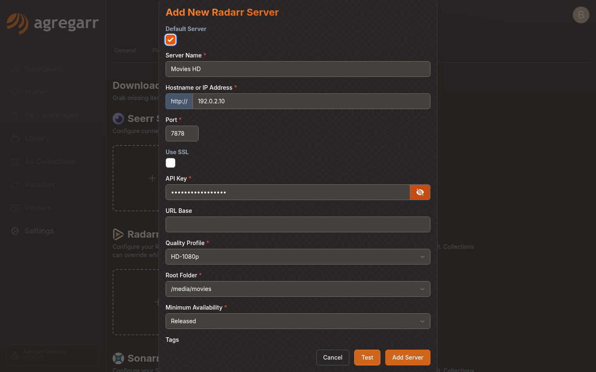
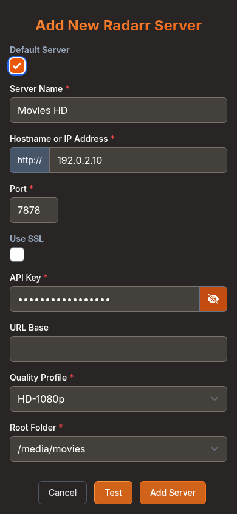
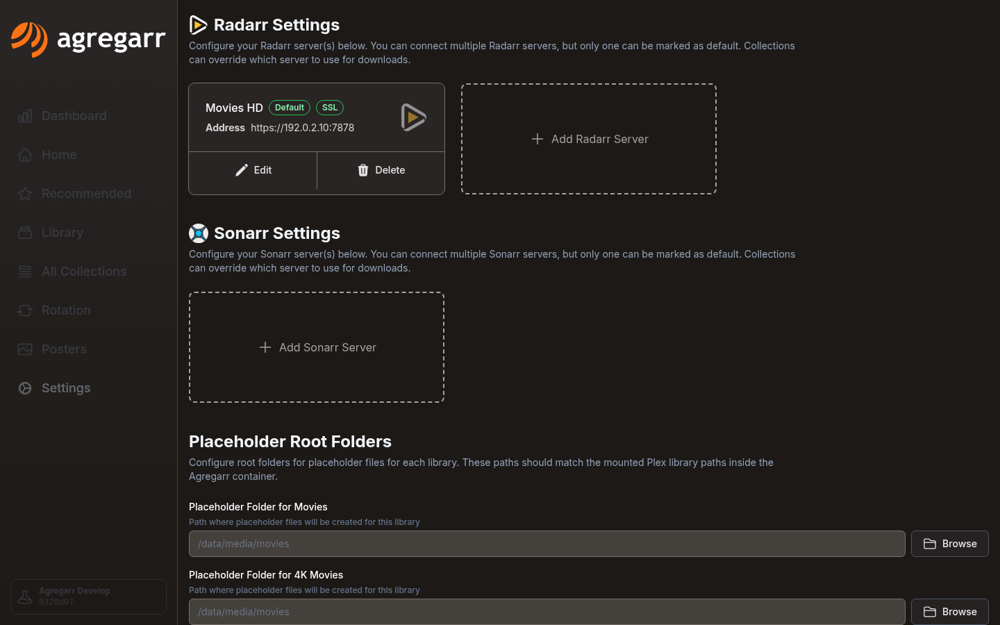
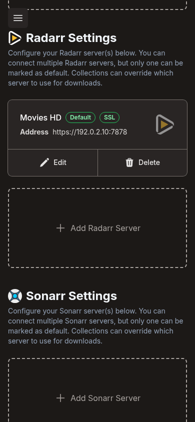

# Radarr

Connect Radarr so Agregarr can add missing movies from a collection, tag them and read what Radarr already knows about your library.

## What Agregarr uses Radarr for

- **Adding missing movies.** A collection set to **Download via Radarr/Sonarr** sends its missing movies to Radarr. Before adding them, Agregarr skips movies on Radarr's import exclusions and movies Radarr already has a file for. See [Grab Missing Items](../collections/form/visibility.md#grab-missing-items-auto-request).
- **Watchlist adds.** **Plex Watchlist Sync** adds watchlisted movies to Radarr. The **Download via Radarr** button in a collection preview adds one movie.
- **Tagging.** Agregarr can tag every movie it adds and movies Radarr already has. See [What Agregarr writes in Radarr](#what-agregarr-writes-in-radarr).
- **Reading.** **Radarr Tag** collections list everything carrying a tag ([Your servers](../collections/sources/your-servers.md#radarr-tag-and-sonarr-tag)). **Coming Soon** collections read the movies Radarr monitors ([Coming Soon](../collections/sources/coming-soon.md)). Overlays can use **In Radarr**, **Is Monitored** and **Radarr Tags**. A Coming Soon placeholder uses Radarr's digital and physical dates when they're available ([Release fields](../overlays/fields/release.md)).

You can connect more than one Radarr server. One server is the default.

If you'd rather approve each addition, use [Seerr](seerr.md) instead. You can set up both and choose per collection.

## Requirements

- A Radarr server that Agregarr can reach on your network. Agregarr uses Radarr's `/api/v3` API.
- Radarr's API key.
- At least one quality profile and one root folder in Radarr.

Agregarr runs in a container, so `localhost` points to the Agregarr container, not Radarr. Use the server's address on your network, such as `192.0.2.10`, or the container name when both containers share a Docker network.

## Get the credentials

1. Open Radarr and go to **Settings > General**.
2. Copy the **API Key**.
3. Note the address and port Radarr listens on. Radarr's default port is 7878. If Radarr runs under a path such as `/radarr`, note that as well. This is the **URL Base**.

## Connect

1. Go to **Settings > Downloads**. The **Radarr Settings** section is second, after **Seerr Settings**.
2. Click **Add Radarr Server**. The **Add New Radarr Server** window opens.

=== "Desktop"

    

=== "Phone"

    

3. Enter a **Server Name**, then the **Hostname or IP Address**, **Port** and **API Key**. Tick **Use SSL** if Radarr is served over HTTPS. Fill in **URL Base** only if Radarr uses one.
4. Click **Test**.

**Check:** the **Quality Profile** and **Root Folder** lists fill with the values from Radarr. They stay greyed out until the test passes. From the second test in the same window, a toast also reads "Radarr connection established successfully!". When a test fails, the toast reads "Failed to connect to Radarr." and the lists stay empty.

5. Choose a **Quality Profile** and a **Root Folder**.
6. Tick **Default Server** if collections should use this server unless they choose another.
7. Click **Add Server**.

**Check:** a card appears under **Radarr Settings** with the server name, a **Default** badge if you ticked it, **SSL** if you ticked it, the **Address** and the **Edit** and **Delete** buttons.

=== "Desktop"

    

=== "Phone"

    

Use **Edit** to change a server later. The window is called **Edit Radarr Server**. It tests the saved connection when it opens and saves with **Save Changes**. If you change the **Hostname or IP Address**, **Port**, **Use SSL**, **API Key** or **URL Base**, click **Test** again before saving.

Click **Delete**, then confirm in the **Delete Radarr Server** window. Collections pointing at that server, including direct downloads, Coming Soon and Radarr Tag, lose the server choice and its related settings. Their monitor and search choices stay. **Plex Watchlist Sync** also loses its server, profile, root folder and tags. If you delete the default server, no server is the default until you tick one.

## Options

The options below follow the order shown in the window. Required fields are marked there.

### Default Server

Default: unticked. Marks this server as the default. Ticking it clears the badge from every other Radarr server. Any collection without its own server choice uses the default. When you add a collection, its server, profile, root folder and tags start with the default server's values. When no server is the default, they start with the first server's values.
<!-- OPEN: M4 is4k can't be set in the Radarr modal -->

If no server is the default, a banner above the cards reads "At least one Radarr server must be marked as default in order for movie requests to be processed."

### Server Name

Default: empty. Required. This name appears on the card and in every server list, including the **Radarr Instance** list for a **Radarr Tag** collection.

### Hostname or IP Address

Default: empty. Required. The Radarr server's address without `http://` or `https://`. The window adds the prefix and changes it when you tick **Use SSL**.

### Port

Default: 7878. Required.

### Use SSL

Default: unticked. Makes Agregarr connect to Radarr over HTTPS.

### API Key

Default: empty. Required. The key from Radarr's **Settings > General**. The field is masked.

### URL Base

Default: empty. Fill this in when Radarr is served under a path. It must start with `/` and must not end with `/`, for example `/radarr`. Otherwise, the window warns "URL base must have a leading slash" or "URL base must not end in a trailing slash".

### Quality Profile

Default: none. Required. Loads after a successful **Test**. Agregarr uses this profile for movies added through this server unless the collection chooses another one.

### Root Folder

Default: none. Required. Loads after a successful **Test**. Radarr stores movies added by Agregarr here unless the collection chooses another folder.

### Minimum Availability

Default: **Released**. Required. The choices are **Announced**, **In Cinemas** and **Released**. Agregarr passes this value to Radarr for every movie it adds. This is Radarr's setting for when a movie is ready to search for.

### Tags

Default: none. Loads after a successful **Test** and lists the tags already in Radarr. Every movie Agregarr adds through this server gets these tags, regardless of the collection's choices.

### Monitor by Default

Default: ticked. Movies Agregarr adds are monitored in Radarr. Clear it to add them unmonitored. A collection can override this with its own **Monitor Movies** tick box. That box starts with this value when you create the collection.
<!-- OPEN: M3 Sonarr modal never renders Monitor by Default; Radarr does -->

### Search on Add

Default: ticked. Radarr starts searching as soon as Agregarr adds a movie. A collection can override this with **Search on Add (Movies)**, which starts with this value.

### Tag Existing Items

Default: unticked. The window's help reads "Apply collection tags to items that already exist in Radarr during collection sync." When enabled, a sync adds the collection's tags to movies in that collection that Radarr already has. It never removes tags.

This only affects movies that are in Plex and known to Radarr by TMDB ID. It adds the automatic tag from **Automatic Tag Mode** and the Radarr tags selected on the collection. A single-source collection with no Radarr or Sonarr tags selected is skipped, even when an automatic tag mode is enabled. A **Multiple Sources** collection isn't skipped.

Tag Existing Items tags the server selected by the collection, except when the collection points at the first server you added. In that case, it tags the default server instead, or the first server when there is no default. It only does this when that server has Tag Existing Items ticked.
<!-- OPEN: NEW: server id 0 is falsy in ExistingItemTagService.ts:109-111 (`serverId ? find(id) : find(isDefault) || [0]`), while DirectDownloadService.ts:250 uses `??`, so adds and tagging can go to different servers. Class: code bug -->

For a **Request via Seerr** collection, Tag Existing Items uses the tags and server chosen under **Seerr Server Configuration**. It looks for the Agregarr Radarr server with the same id as the Seerr server selected there. With more than one server, this can tag the wrong server.
<!-- OPEN: NEW: single-source collections skip Tag Existing Items when no collection tags are selected, though the automatic tag alone would be applied; Multiple Sources doesn't skip -->

### External URL

Default: empty. A link used by the card's name and icon when you open Radarr from outside your network. It must be a full URL such as `https://radarr.example.com` without a trailing slash. It doesn't change how Agregarr connects.

### Automatic Tag Mode

Default: **Do not add automatic tags**. The window's help reads "Choose how Agregarr tags Radarr downloads (tags are created if they do not exist)." The choices:

- **Do not add automatic tags**: no tag from Agregarr.
- **Single tag (agregarr)**: every movie gets `agregarr`.
- **Per service tags (trakt-agregarr, tmdb-agregarr)**: one tag per source type, such as `tmdb-agregarr`.
- **Per collection tags (trakt-trending-agregarr)**: one tag per collection type, such as `imdb-top-250-agregarr`.

Agregarr adds the tag to every movie it sends through this server. With **Tag Existing Items** enabled, it also adds the tag to movies Radarr already has.

## What Agregarr writes in Radarr

Agregarr makes three kinds of changes in Radarr and no others.

- **Tags.** When an automatic tag doesn't exist, Agregarr creates it. Names use lower case and dashes. Per service tags use the source type: `tmdb-agregarr`, `trakt-agregarr`, `imdb-agregarr`, `letterboxd-agregarr` and so on. Per collection tags insert the sub-type, or the collection name when there is no sub-type: `imdb-top-250-agregarr`. If Radarr already has a tag with that name in any capitalisation, Agregarr uses it.
- **Movies.** For each missing movie that passes the collection's filters, Agregarr adds one movie using the server's **Quality Profile**, **Root Folder**, **Minimum Availability**, tags, **Monitor by Default** and **Search on Add**, or the collection's own overrides. The year comes from the list. When the list has no year, Agregarr uses the current year.
- **Tags on movies already in Radarr.** A movie already held by Radarr gets the tags and no other changes. When adding missing movies, Agregarr skips a movie that already has its file. An unmonitored movie stays unmonitored and gets no tag. A monitored movie without a file gets the tags and nothing else. **Tag Existing Items** works separately: it tags every matching movie in Plex, whether monitored or not.

Agregarr doesn't delete, unmonitor or rename movies, edit profiles or folders or run Radarr commands. Placeholders for missing movies are files on disk, not Radarr entries. See [Placeholders](../Placeholders.md).

## Limits

- Agregarr matches movies by TMDB ID. It doesn't match a movie that Radarr lists without one.
- A collection stores its own server, profile, root folder, tags and monitor choices when you create it. Changing the server's values later doesn't update collections you already created.

## If it didn't work

- **Test fails with "Failed to connect to Radarr."** Check the address and port from inside the Agregarr container, then check **Use SSL**, the **URL Base** and the API key. A **Radarr Connection** health check reports every server it can't reach. See [Health Checks](../Health-Checks.md).
- **Quality Profile and Root Folder stay greyed out.** The window loads them after a successful **Test**. Changing the address, port, **Use SSL**, **API Key** or **URL Base** clears the test result, so run **Test** again.
- **Add Server stays disabled.** Run a successful test and fill in every required field.
- **Movies aren't added.** Check the collection's **Download Method**. Confirm that a default server exists or that the collection names one. Check for the missing-default banner under **Radarr Settings**.
- **A movie got no tag.** A movie monitored by Radarr without a file gets tagged when Agregarr tries to add it. No extra setting is needed. A movie that is unmonitored or already has its file only gets tagged through **Tag Existing Items**. The box must be ticked on the server, the movie must be in Plex and a single-source collection must have at least one Radarr or Sonarr tag selected.

## Related

- [Sonarr](sonarr.md) and [Seerr](seerr.md)
- [Show what people request and watch](../collections/requests-and-watching.md)
- [Placeholders](../Placeholders.md)
- [Health Checks](../Health-Checks.md)
