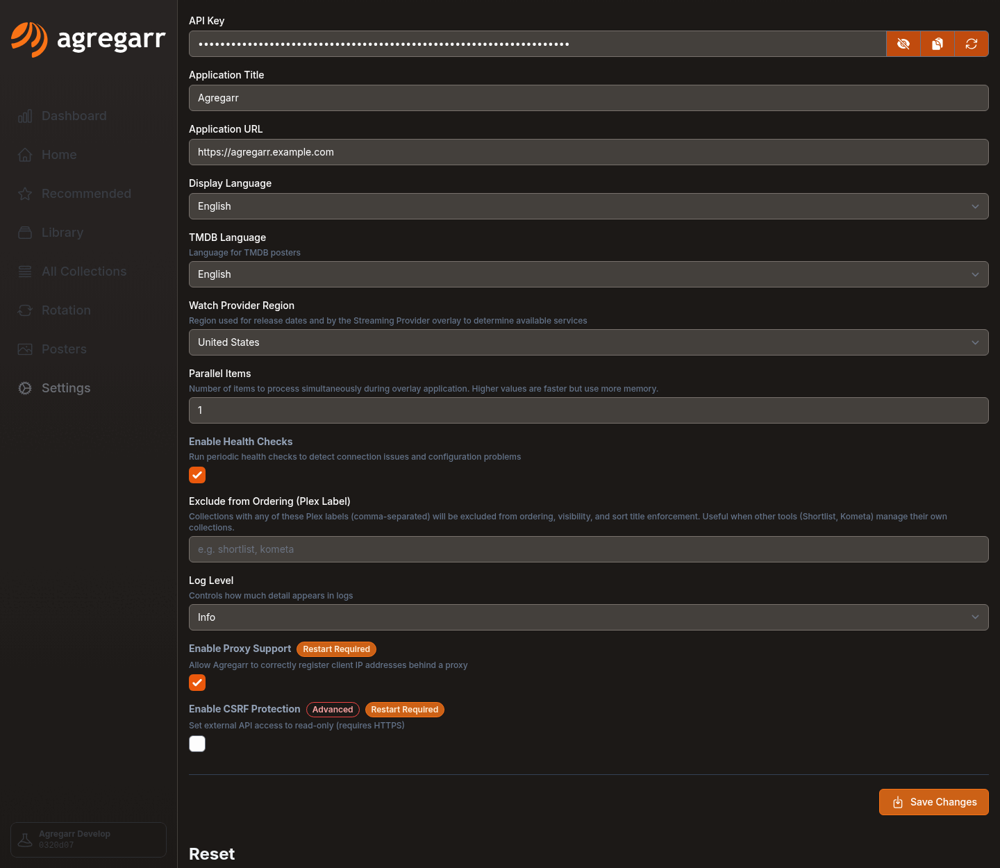
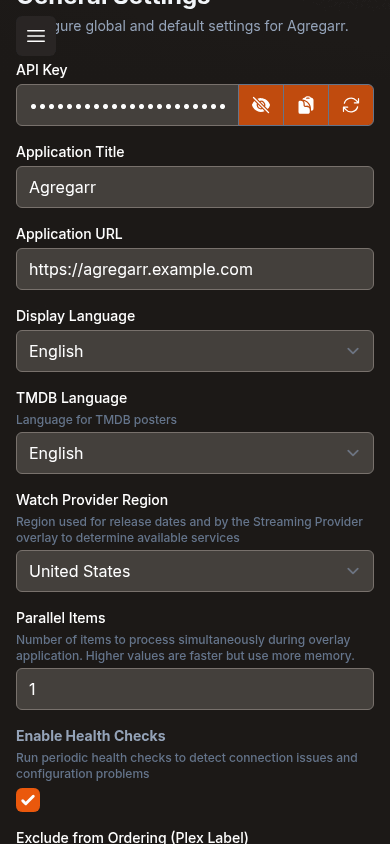
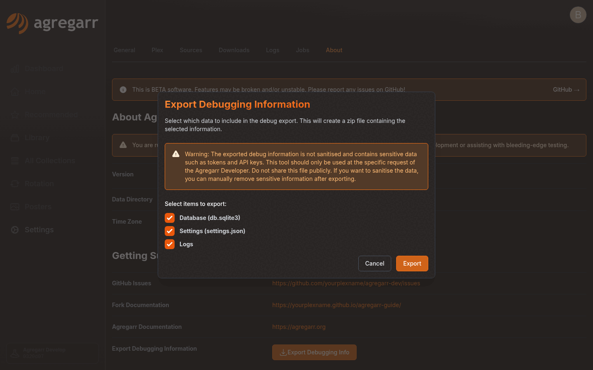
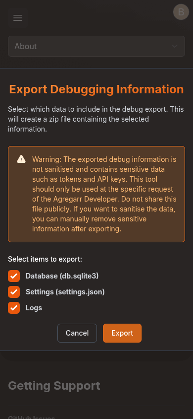

# Reverse proxy, API key and debugging export

This page covers four things beside the Plex connection: running Agregarr behind a reverse proxy, the API key, the `/api-docs` page and **Export Debugging Information**. The proxy and API key settings are under **Settings > General**.

## Run Agregarr behind a reverse proxy

A reverse proxy gives Agregarr an address such as `https://agregarr.example.com` instead of `http://YOUR_SERVER:7171`. Agregarr listens on port `7171` inside its container.

### What you need

- A reverse proxy that forwards a host name to Agregarr's port `7171`.
- A separate host name for Agregarr. There's no setting for a URL base or sub-path, so `https://example.com/agregarr/` isn't supported.
- Usually a certificate on the proxy, so the public address uses `https`.

### Set it up

1. Point the proxy at `http://YOUR_SERVER:7171`, then open the public address in a browser.

    **Check:** the Agregarr sign-in or **Dashboard** page loads at the public address.

2. Go to **Settings > General**.
3. Set **Application URL** to the public address without a trailing slash. For example, `https://agregarr.example.com`.
4. Tick **Enable Proxy Support**.
5. Click **Save Changes**, then restart the Agregarr container. Both **Enable Proxy Support** and **Enable CSRF Protection** have a **Restart Required** badge. Agregarr doesn't prompt you to restart after saving, so restart it yourself.

    **Check:** after the restart, **Settings > General** shows **Enable Proxy Support** ticked and **Application URL** filled in. You can still sign in at the public address.

=== "Desktop"

    

=== "Phone"

    

Fetching a list's title in the Add Collection form streams the result to the browser as server-sent events. If it never finishes behind your proxy, turn off response buffering for Agregarr in the proxy's settings.

### Enable Proxy Support

Default: off. Restart Required. Its description reads "Allow Agregarr to correctly register client IP addresses behind a proxy".

Ticking it tells Agregarr to trust the `X-Forwarded-For` and `X-Forwarded-Proto` headers sent by the proxy. Without it, Agregarr reads every request as coming from the proxy over plain HTTP. Tick it whenever a proxy sits in front of Agregarr and make sure the proxy sends both headers.

### Application URL

Default: empty. Optional. Set this to Agregarr's public address without a trailing slash. Saving shows "You must provide a valid URL" when the value isn't a URL. If it ends in `/`, saving shows "URL must not end in a trailing slash".

Agregarr uses this as the fallback for the `{domain}` variable in collection titles. If Agregarr has never read an address from Seerr, it fills `{domain}` from here. On a Seerr Requests collection with Seerr reachable, `{domain}` always comes from Seerr. **Connect with Trakt** doesn't use it. Trakt shows a code that you paste back into Agregarr, so there is no browser redirect. See [Name collections](../collections/name-collections.md#domain).
<!-- OPEN: NEW: Application URL also changes the redirect URI sent on Trakt token refresh (traktAuth.ts:12, media-type.ts:62) while Connect with Trakt always uses urn:ietf:wg:oauth:2.0:oob -->

### Application Title

Default: `Agregarr`. Required. This is the name shown in the browser tab and page titles, as in "Plex - Settings - Agregarr". It doesn't change the logo or sidebar.

If Agregarr has never read a title from Seerr, it also fills the `{appTitle}` variable in collection titles. On a Seerr Requests collection with Seerr reachable, the title comes from Seerr. When Seerr has no title, Agregarr uses "Overseerr". See [Name collections](../collections/name-collections.md#apptitle).

### Enable CSRF Protection

Advanced. Restart Required. Default: off. Its description reads "Set external API access to read-only (requires HTTPS)".

With it on, Agregarr's own pages keep working because they send a token cookie set by Agregarr. Scripts and other apps calling the API with a key can read data but can't change anything.

The hover text says "Do NOT enable this setting unless you understand what you are doing!". Agregarr sets its cookies as secure when it runs normally, so browsers only keep them over `https`. Only turn it on when you reach Agregarr over `https`.

!!! warning
    If you turn this on and sign-in or saving stops working, such as when you reach Agregarr over plain `http`, undo it. Stop the container, set `csrfProtection` to `false` under `main` in `settings.json` in your config folder and start it again.

## The API key

Everything Agregarr's web pages do goes through its API. You can call the API yourself with the API key, including from a script.

### API Key

**Settings > General**, first field. The key is masked and only shown to the admin. Two icon buttons sit beside it. The first copies the key and the second regenerates it. Neither has a label.

Send the key in an `X-Api-Key` header to `http://YOUR_SERVER:7171/api/v1/`. Put the key in an `AGREGARR_API_KEY` environment variable first, then this command checks that it works:

```
curl -H "X-Api-Key: $AGREGARR_API_KEY" http://YOUR_SERVER:7171/api/v1/status/health
```

A request using the key acts as the first admin account. Add an `X-API-User` header with another user's ID to act as that user.
<!-- OPEN: M1: Settings routes only check that a user is signed in, so the key is returned to any signed-in user, not only the admin -->

### Regenerate the key

Click the second icon beside **API Key**. There is no confirmation. A toast says "New API key generated successfully!" and the old key stops working straight away. Anything using the old key, such as a script, gets "Authentication required" until you give it the new key.

## The API docs page

Agregarr serves its API reference at `http://YOUR_SERVER:7171/api-docs`. It's a Swagger page that lists every endpoint, with a **Try it out** button on each one. Agregarr doesn't link to it, so type the address directly.

The page opens without signing in. Calls made from it still need your API key or a signed-in session. The **Servers** box at the top starts as `http://localhost:7171`. Change its `server` value to the address where you opened the page. Otherwise, **Try it out** calls your own computer.
<!-- OPEN: M8: the spec documents /auth/local, which has no server route -->

## Export Debugging Information

Use this when a maintainer asks for a copy of your setup to diagnose a problem. It creates a zip file for you to download.

### Set it up

1. Go to **Settings > About** and click **Export Debugging Info** in the **Export Debugging Information** row. The same button is at the top of **Settings > Logs**.
2. In the window, leave the boxes ticked for anything you want to include: **Database (db.sqlite3)**, **Settings (settings.json)** and **Logs**. All three start ticked. You need to leave at least one ticked.
3. Click **Export**.

    **Check:** your browser downloads a file named `agregarr-debug-` followed by the date and time and ending in `.zip`. A toast says "Debug export downloaded successfully".

=== "Desktop"

    

=== "Phone"

    

!!! warning
    The export isn't sanitised. It contains sensitive data such as tokens and API keys. The window tells you to use it only when the maintainer asks and never share the file publicly. The database holds your Plex sign-in. **settings.json** holds your API key and the keys for every connected service. Before sharing it, unzip it and remove the sensitive information.

The zip contains `db/db.sqlite3`, `settings.json` and a `logs` folder, depending on which boxes you ticked.

## Limits

- Agregarr has no URL base. It has to sit at the root of its own host name.
- You need to restart manually after changing **Enable Proxy Support** or **Enable CSRF Protection**.
- The whole install uses one API key. There isn't a separate key for each person or script.

## If it didn't work

- **The public address doesn't load at all.** The proxy isn't forwarding to port `7171` or it can't reach Agregarr. Open `http://YOUR_SERVER:7171` directly to check which one.
- **A script gets "Authentication required".** The `X-Api-Key` header is missing or it contains the old key. Copy the key again from **Settings > General**.
- **A script can read but its changes are refused.** **Enable CSRF Protection** is on. If the script needs write access, untick it, save and restart.
- **Saving works but nothing changes.** You changed **Enable Proxy Support** or **Enable CSRF Protection** without restarting the container.
- **Try it out on `/api-docs` can't connect.** The `server` value still reads `localhost`. Change it to the address where you opened the page.

## Related

- [Connect services](index.md)
- [Plex](plex.md)
- [Install with Docker Compose](../get-started/install-docker.md)
- [Settings](../Settings.md#general)
