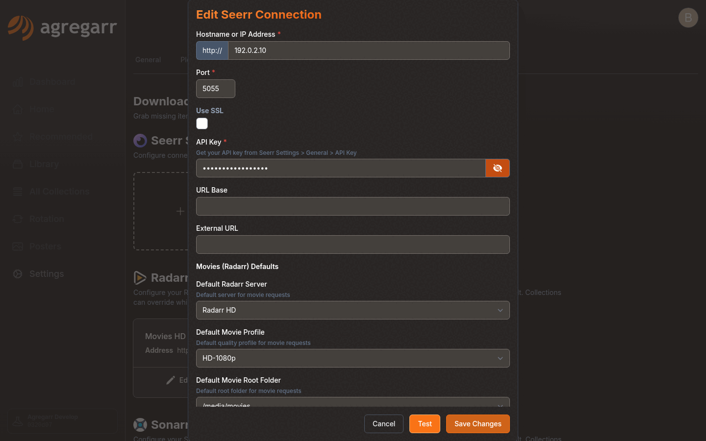
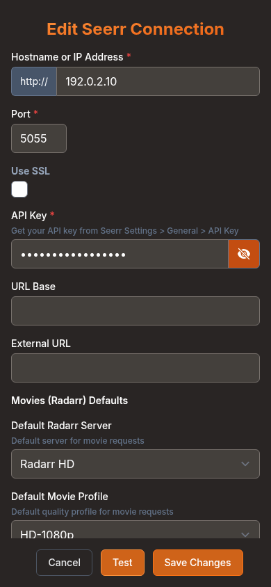
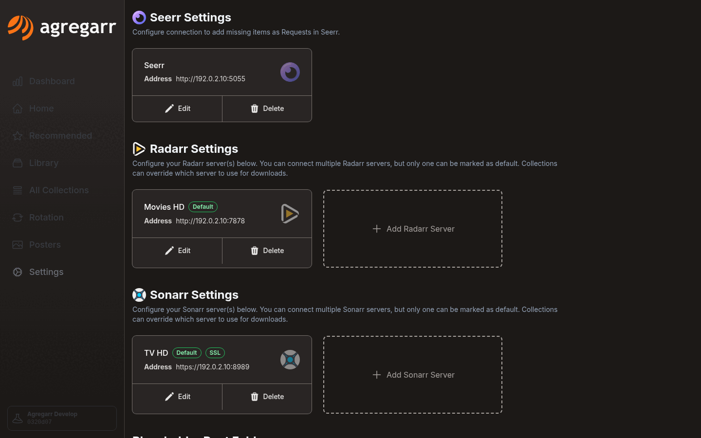
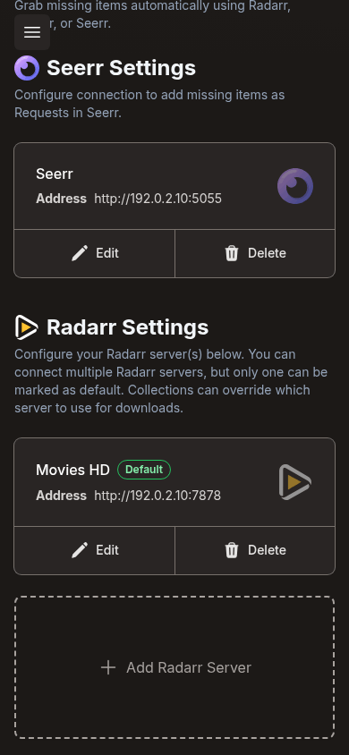

# Seerr

Connect Seerr to let Agregarr request missing collection titles and read what your users have requested.

## What Agregarr uses Seerr for

- **Requests for missing titles.** A collection set to **Request via Seerr** creates a Seerr request for each missing title. Requests can need approval or be approved straight away. See [Grab Missing Items](../collections/form/visibility.md#grab-missing-items-auto-request).
- **Reading requests.** **Seerr Requests** collections list the titles your users requested ([Activity sources](../collections/sources/activity.md#seerr-requests)). Agregarr also reads existing Seerr requests so it doesn't request the same title twice.
- **Keeping placeholders out of "available".** Seerr treats a placeholder file as real media and marks the title available, which stops anyone requesting it. Agregarr can add two ignore patterns to Seerr to stop that. See [Keep placeholder ignore patterns in Seerr](#keep-placeholder-ignore-patterns-in-seerr).

The setup wizard recommends Seerr over Radarr and Sonarr. You can set up both, then choose per collection. See [Radarr](radarr.md) and [Sonarr](sonarr.md).

## Requirements

- A Seerr server Agregarr can reach over your network.
- Seerr's API key. Agregarr uses it to create users, set their permissions and read every request.
- Radarr and Sonarr already added inside Seerr. Seerr sends approved requests to them, not Agregarr.
- For **Individual Users Requests** collections, each person's Seerr account linked to their Plex account.
- For the placeholder patterns, a Seerr build with an **Ignored Path Patterns** setting. The window names `rubeanie/seerr:ignore-media-regex` as one.

Agregarr runs in a container. `localhost` points to the Agregarr container itself, not Seerr. Use the server's network address, such as `192.0.2.10`, or the container name when both containers share a Docker network.

## Get the credentials

1. Open Seerr and go to **Settings > General**.
2. Copy the **API Key**.
3. Note the address and port Seerr listens on. Seerr's default port is 5055. If Seerr runs behind a path, note that as well. That's the **URL Base**.

## Connect

1. Go to **Settings > Downloads**. **Seerr Settings** is the first section. Its description reads "Configure connection to add missing items as Requests in Seerr."
2. Click **Add Seerr Connection**. The **Add Seerr Connection** window opens.

=== "Desktop"

    

=== "Phone"

    

3. Enter the **Hostname or IP Address**, **Port** and **API Key**. Tick **Use SSL** if Seerr uses HTTPS. Fill in **URL Base** only when Seerr uses one.
4. Click **Test**.

**Check:** **Default Radarr Server** and **Default Sonarr Server**, greyed out until now, list the servers added inside Seerr. From the second test in the same window, a toast also reads "Seerr connection established successfully!". A second toast begins "Template variables updated:" and includes Seerr's title and address. When a test fails, a toast gives the reason and the lists stay empty.

5. Optional: choose the defaults under **Movies (Radarr) Defaults** and **TV Shows (Sonarr) Defaults**.
6. Review **Create Seerr users for Requests**. It starts on **Per service (TraktAgregarr, TMDbAgregarr)**, which suits most setups.
7. Click **Add Connection**.

**Check:** a card named **Seerr** appears under **Seerr Settings** with its **Address**, **Edit** and **Delete** buttons. The **Add Seerr Connection** button is gone because Agregarr keeps one Seerr connection.

=== "Desktop"

    

=== "Phone"

    

Use **Edit** to change the connection later. The window is called **Edit Seerr Connection**. It tests the saved connection when it opens and saves with **Save Changes**. After changing the **Hostname or IP Address**, **Port**, **Use SSL**, **API Key** or **URL Base**, click **Test** again before saving.

Click **Delete**, then confirm in the **Delete Seerr Server** window. Agregarr forgets the connection. Any users it created in Seerr and requests it made stay there.

## Options

The options below follow the order used in the window.

### Hostname or IP Address

Default: empty. Required. Enter the Seerr server's address without `http://` or `https://`. The window shows the prefix and changes it when you tick **Use SSL**.

### Port

Default: 5055. Required.

### Use SSL

Default: unticked. Makes Agregarr connect to Seerr over HTTPS.

### API Key

Default: empty. Required. The window's tip reads "Get your API key from Seerr Settings > General > API Key". The field is masked.

### URL Base

Default: empty. Fill this in when Seerr is served under a path. It must start with `/` and must not end with `/`. Otherwise, the window warns "URL base must have a leading slash" or "URL base must not end in a trailing slash".

### External URL

Default: empty. A link used by the card's name and icon when you open Seerr from outside your network. It must be a full URL with no trailing slash. It doesn't affect how Agregarr connects.

### Movies (Radarr) Defaults

The next four options set the starting values for **Request via Seerr** collections. They don't change requests that existing collections make. When you add a collection, its **Seerr Server Configuration** starts with these values and the collection keeps its own copy. If a collection has no server selected, Agregarr sends the request with server id 0 instead of leaving the field out. Check Seerr to see which server received those requests.
<!-- OPEN: NEW: requests with no server chosen are sent with serverId 0, not left to Seerr's default -->

#### Default Radarr Server

Default: none. The window's tip reads "Default server for movie requests". The list shows the Radarr servers configured inside Seerr, using the names Seerr gives them. These aren't the servers shown on your [Radarr](radarr.md) card. The list stays greyed out until a **Test** succeeds. Choosing a server clears the profile and root folder below.

When the selected Seerr server is configured as a 4K server, Agregarr sends 4K requests to it.

#### Default Movie Profile

Default: none. Tip: "Default quality profile for movie requests". Lists the quality profiles from the server above. Greyed out until you choose a server.

#### Default Movie Root Folder

Default: none. Tip: "Default root folder for movie requests". Lists the root folders from the server above. Greyed out until you choose a server.

#### Default Tags

Default: none. Tip: "Default tags for requests". Lists the tags on the Radarr server chosen above. Greyed out until you choose a server.

### TV Shows (Sonarr) Defaults

These are the same four options for TV and work the same way.

#### Default Sonarr Server

Default: none. Tip: "Default server for TV show requests". Choosing a server clears the profile and root folder below.

#### Default TV Profile

Default: none. Tip: "Default quality profile for TV show requests".

#### Default TV Root Folder

Default: none. Tip: "Default root folder for TV show requests".

#### Default Tags

Default: none. Tip: "Default tags for requests". Lists the tags on the Sonarr server chosen above.

### Create Seerr users for Requests

Default: **Per service (TraktAgregarr, TMDbAgregarr)**. Agregarr makes each request through a Seerr user it creates for that purpose. This option controls how many users Agregarr creates and how requests are identified inside Seerr.

- **Single user (Agregarr)**: one user named `Agregarr` for everything.
- **Per service (TraktAgregarr, TMDbAgregarr)**: one user for each source type. The source name is followed by `Agregarr`, giving names such as `TraktAgregarr`, `TMDBAgregarr`, `IMDbAgregarr` or `LetterboxdAgregarr`.
- **Granular (TraktTrendingAgregarr, TMDbPopularAgregarr)**: one user for each collection. The name uses the source name, then the collection's name with its first letter capitalised and spaces kept, then `Agregarr`. A TMDB collection called "trending today" creates `TMDBTrending todayAgregarr`.
<!-- OPEN: NEW: Granular user names are built from the collection name (with spaces), not the short sub-type the option label shows -->

The setting is saved with the connection. Agregarr creates a user when a request first needs it, not when you save the connection. If you change modes later, the old users remain in Seerr. Delete them from Seerr by hand when you no longer need them.

### Keep placeholder ignore patterns in Seerr

Default: unticked. The window's help reads "Adds the two regexes Agregarr's placeholders match to Seerr's Ignored Path Patterns and re-adds them if they go missing. Needs a Seerr build with that setting (rubeanie/seerr:ignore-media-regex)."

When enabled, one pattern matches movie placeholder files ending `{edition-Trailer}.mp4`, `{edition-Placeholder}.mp4` or `{edition-Coming Soon}.mp4`. The other matches the TV placeholder file `Season 00/S00E00.Trailer.mp4`. Saving the window with the box ticked adds both patterns to Seerr straight away. Each full **Plex Collections Sync** then checks Seerr and adds any missing pattern again.

Once the connection is saved, the state appears beside the box: **Both patterns present**, **{count} of 2 patterns missing** or **Seerr build doesn't support Ignored Path Patterns**. A missing pattern means Seerr refused it, so check Seerr's log.

Clearing the box stops Agregarr checking. It doesn't remove the patterns from Seerr. The **Seerr Placeholder Patterns** health check reports problems. See [Health Checks](../Health-Checks.md#the-seerr-check) and [Placeholders](../Placeholders.md#seerr).

## What Agregarr writes in Seerr

- **Users.** Local Seerr users created by Agregarr, named as described under **Create Seerr users for Requests**. Each user has an email starting `donotchangeme@` and ending `.invalid`, a random password nobody receives and every notification switched off. Agregarr changes each user's permissions to match the collection making the request. Collections that auto-approve use permissions that let Seerr approve the request straight away. Collections that don't auto-approve use permissions that only let the user ask.
- **Requests.** One request for each missing title that passes the collection's filters, made through the service user. The **Request via Seerr** button in a collection preview also makes a request through a service user. That request is auto-approved. Movie requests use the server, profile, root folder and tags chosen by the collection. TV requests also include the seasons allowed by the collection. Agregarr skips any title that already has a request from anyone unless that request was declined. For requests needing approval, it also skips titles declined for one of its own users.
- **Ignored Path Patterns.** Only written when **Keep placeholder ignore patterns in Seerr** is on. Agregarr adds the two patterns and leaves everything else in the list untouched.

Agregarr also keeps its own record of every request it makes. The **Test** button and each sync store Seerr's title and address in Agregarr for the `{appTitle}` and `{domain}` title variables. See [Name collections](../collections/name-collections.md).

Agregarr doesn't approve, decline or delete requests. It also doesn't edit other users or change Seerr's servers.

## Limits

- Agregarr keeps one Seerr connection.
- Duplicate checks read up to 5000 requests from Seerr.
- **Seerr Requests** collections only list requested titles already in Plex. Requests for titles not yet in Plex are handed on as missing items.
- Seerr has its own watchlist sync, but placeholder files count as available. That's why Agregarr has a **Plex Watchlist Sync** section on the same page.

## If it didn't work

- **Test fails.** The toast gives the reason and ends with the address you entered in brackets. "Invalid API key - Authentication failed" points to the key. "Connection refused - Check hostname and port", "Host not found - Check hostname" and "Connection timeout - Check network connectivity" mean the Agregarr container can't reach Seerr. "Overseerr API not found - Check URL base and port" means something answered at the address, but the API isn't at that path. Some messages still use Seerr's older name.
- **Add Connection stays disabled.** A successful test and every required field are needed.
- **The default server lists are empty.** The lists fill after a successful **Test** and only show servers already added inside Seerr.
- **Requests don't appear in Seerr.** Check that the collection's **Download Method** is **Request via Seerr** and **Grab Missing Items** is on. When Agregarr can't create the Seerr user it needs, the log says "has no external Overseerr ID" and skips the title for that run.
- **Placeholders still show as available.** Check the status beside **Keep placeholder ignore patterns in Seerr**. See [Health Checks](../Health-Checks.md#the-seerr-check).

## Related

- [Radarr](radarr.md) and [Sonarr](sonarr.md)
- [Activity sources](../collections/sources/activity.md#seerr-requests)
- [Placeholders](../Placeholders.md#seerr)
- [Health Checks](../Health-Checks.md#the-seerr-check)
