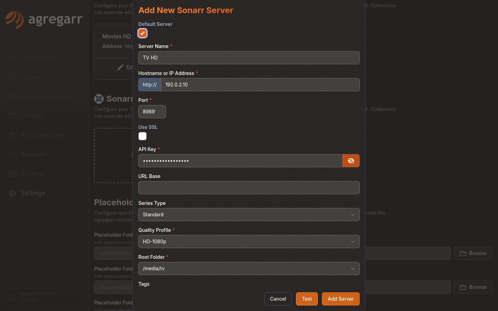
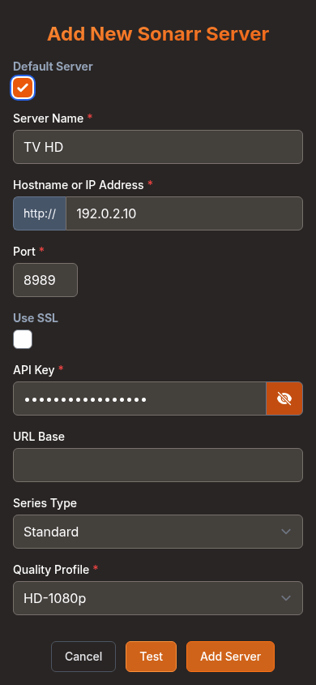
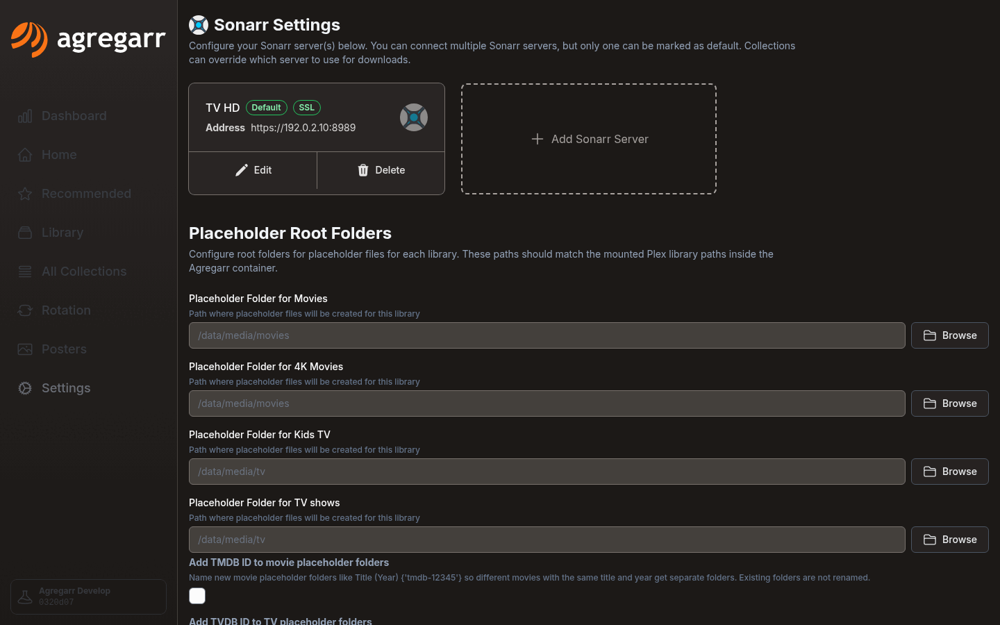
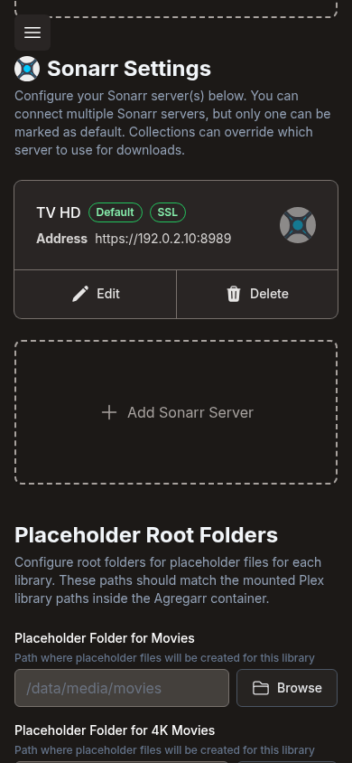

# Sonarr

Connect Sonarr so Agregarr can add shows missing from a collection, tag them and ask Sonarr when the next episode airs.

## What Agregarr uses Sonarr for

- **Adding missing shows.** A collection set to **Download via Radarr/Sonarr** sends missing shows to Sonarr. Before adding them, Agregarr skips shows on Sonarr's import exclusions and shows Sonarr already has episodes for. See [Grab Missing Items](../collections/form/visibility.md#grab-missing-items-auto-request).
- **Watchlist adds.** **Plex Watchlist Sync** adds watchlisted shows to Sonarr. The **Download via Sonarr** button in a collection preview adds a single show.
- **Tagging.** Agregarr can add a tag to every show it adds and to shows already in Sonarr. See [What Agregarr writes in Sonarr](#what-agregarr-writes-in-sonarr).
- **Reading.** **Sonarr Tag** collections list everything carrying a tag ([Your servers](../collections/sources/your-servers.md#radarr-tag-and-sonarr-tag)). **Coming Soon** collections read the shows Sonarr monitors ([Coming Soon](../collections/sources/coming-soon.md)). Overlays can use **In Sonarr**, **Is Monitored**, **Sonarr Tags** and the episode fields ([Overlay variables](../Overlay-Variables.md)).
- **Next-episode dates.** Agregarr asks Sonarr first when an overlay needs a show's next episode. See [Sonarr-first next-episode dates](#sonarr-first-next-episode-dates).

You can connect more than one Sonarr server. One server is the default.

If you'd rather approve each addition, use [Seerr](seerr.md) instead. You can set up both and choose per collection.

## Requirements

- A Sonarr server that Agregarr can reach on your network. Agregarr uses Sonarr's `/api/v3` API.
- Sonarr's API key.
- At least one quality profile and one root folder in Sonarr.

Agregarr runs in a container. `localhost` inside it points to the Agregarr container, not Sonarr. Use the Sonarr server's network address, such as `192.0.2.10`, or its container name when both containers share a Docker network.

## Get the credentials

1. Open Sonarr and go to **Settings > General**.
2. Copy the **API Key**.
3. Note the address and port Sonarr listens on. Sonarr's default port is 8989. If Sonarr runs under a path such as `/sonarr`, note that too. This is the **URL Base**.

## Connect

1. Go to **Settings > Downloads**. The **Sonarr Settings** section is third, after **Radarr Settings**.
2. Click **Add Sonarr Server**. The **Add New Sonarr Server** window opens.

=== "Desktop"

    

=== "Phone"

    

3. Enter a **Server Name**, then the **Hostname or IP Address**, **Port** and **API Key**. Tick **Use SSL** if Sonarr uses HTTPS. Fill in **URL Base** only if Sonarr uses one.
4. Click **Test**.

**Check:** the **Series Type**, **Quality Profile** and **Root Folder** lists are filled with the values from Sonarr. They were greyed out before the test. From the second test in the same window, a toast also reads "Sonarr connection established successfully!". If the test fails, the toast reads "Failed to connect to Sonarr." and the lists stay greyed out.

5. Choose a **Quality Profile** and a **Root Folder**.
6. Tick **Default Server** if collections should use this server unless they choose another.
7. Click **Add Server**.

**Check:** a card is shown under **Sonarr Settings** with the server name, a **Default** badge if you ticked it, **SSL** if you ticked that, the **Address** and **Edit** and **Delete** buttons.

=== "Desktop"

    

=== "Phone"

    

Use **Edit** to change a server later. The window is called **Edit Sonarr Server**. It tests the saved connection when it opens and saves with **Save Changes**. If you change the **Hostname or IP Address**, **Port**, **Use SSL**, **API Key** or **URL Base**, click **Test** again before saving.

To remove a server, click **Delete** and confirm in the **Delete Sonarr Server** window. Collections pointing at that server for direct downloads, Coming Soon or Sonarr Tag lose the server choice and its related settings. Their monitor and search choices stay. **Plex Watchlist Sync** also loses its server, profile, root folder and tags. If you delete the default server, no server is the default until you tick one.

## Options

These follow the order shown in the window. Required fields are marked there.

### Default Server

Default: unticked. Marks this server as the default. Ticking it clears the badge from every other Sonarr server. Collections without their own server use the default. When you add a collection, its server, profile, root folder and tags start with the default server's values. If there is no default, they start with the first server's values.
<!-- OPEN: M4 is4k can't be set in the Sonarr modal -->

If no server is the default, a banner above the cards reads "At least one Sonarr server must be marked as default in order for series requests to be processed."

### Server Name

Default: empty. Required. The name shown on the card and in each server list, including the **Sonarr Instance** list for a **Sonarr Tag** collection.

### Hostname or IP Address

Default: empty. Required. The Sonarr server's address without `http://` or `https://`. The window adds the prefix and changes it when you tick **Use SSL**.

### Port

Default: 8989. Required.

### Use SSL

Default: unticked. Makes Agregarr connect to Sonarr over HTTPS.

### API Key

Default: empty. Required. The key from Sonarr's **Settings > General**. The field is masked.

### URL Base

Default: empty. Fill this in when Sonarr runs under a path. It must start with `/` and must not end with `/`, for example `/sonarr`. Otherwise, the window warns "Base URL must have a leading slash" or "Base URL must not end in a trailing slash".

### Series Type

Default: **Standard**. The choices are **Standard**, **Daily** and **Anime**. Agregarr gives this type to every show it adds through the server, which tells Sonarr how to number and search for its episodes. The choices load after a successful **Test**. If your anime lives in a separate Sonarr server, add that server separately.

### Quality Profile

Default: none. Required. Loads after a successful **Test**. Agregarr uses this profile for shows added to the server when the collection hasn't chosen another one.

### Root Folder

Default: none. Required. Loads after a successful **Test**. Sonarr stores shows added by Agregarr here unless the collection chooses another folder.

### Tags

Default: none. Loads after a successful **Test** and lists the tags already in Sonarr. Every show Agregarr adds through this server gets these tags, regardless of the collection's choices.

### Season Folders

Default: ticked. Sonarr puts each season of an added show in its own folder.

### Monitor Type

Default: **All Episodes (except specials)**. Controls which episodes Sonarr monitors when Agregarr adds a show. The choices are:

- **All Episodes (except specials)**
- **Future Episodes (not yet aired)**
- **Missing Episodes (no files or not aired)**
- **Existing Episodes (have files or not aired)**
- **Recent Episodes (last 90 days + future)**
- **Pilot Episode (first episode only)**
- **First Season (all episodes)**
- **Last Season (all episodes)**
- **None (no episodes monitored)**

Choose **None (no episodes monitored)** to add shows without monitoring them. A collection can override this with its own **Monitor Type (TV Shows)**, which starts with this value when you create the collection.

Sonarr's window doesn't have the **Monitor by Default** tick box found in Radarr's window. **Monitor Type** handles that setting.
<!-- OPEN: M3 Sonarr modal never renders Monitor by Default; Radarr does -->

### Search on Add

Default: ticked. Sonarr searches for missing episodes as soon as Agregarr adds a show. A collection can override this with **Search on Add (TV Shows)**, which starts with this value.

### Tag Existing Items

Default: unticked. The window's help reads "Apply collection tags to items that already exist in Sonarr during collection sync." When enabled, a sync adds the collection's tags to shows in that collection that Sonarr already has. It never removes tags.

This only applies to shows that are in Plex and known to Sonarr by TVDB ID. Agregarr adds the automatic tag from **Automatic Tag Mode** and the Sonarr tags selected on the collection. A single-source collection with no Radarr or Sonarr tags selected is skipped, even when an automatic tag mode is enabled. A **Multiple Sources** collection isn't skipped.

Tag Existing Items tags the server selected by the collection, except when that server is the first one you added. A collection pointing at the first server tags the default server instead, or the first server when no default exists. It only does this when that server has Tag Existing Items ticked.
<!-- OPEN: NEW: server id 0 is falsy in ExistingItemTagService.ts:222-224 (`serverId ? find(id) : find(isDefault) || [0]`), while DirectDownloadService.ts:250 uses `??`, so adds and tagging can go to different servers. Class: code bug -->

For a **Request via Seerr** collection, Tag Existing Items uses the tags and server chosen under **Seerr Server Configuration**. It looks for the Agregarr Sonarr server with the same id as the Seerr server selected there. With more than one server, it can tag the wrong one.
<!-- OPEN: NEW: single-source collections skip Tag Existing Items when no collection tags are selected, though the automatic tag alone would be applied; Multiple Sources doesn't skip -->

### External URL

Default: empty. Sets the link used by the card's name and icon when you access Sonarr from outside your network. It must be a full URL such as `https://sonarr.example.com` with no trailing slash. It doesn't change how Agregarr connects to Sonarr.

### Automatic Tag Mode

Default: **Do not add automatic tags**. The window's help reads "Choose how Agregarr tags Sonarr downloads (tags are created if they do not exist)." The choices are:

- **Do not add automatic tags**: no tag from Agregarr.
- **Single tag (agregarr)**: every show gets `agregarr`.
- **Per service tags (trakt-agregarr, tmdb-agregarr)**: one tag for each source type, such as `tmdb-agregarr`.
- **Per collection tags (trakt-trending-agregarr)**: one tag for each collection type, such as `imdb-top-250-agregarr`.

Agregarr adds the tag to every show added through this server. With **Tag Existing Items** enabled, it also adds the tag to shows already in Sonarr.

## What Agregarr writes in Sonarr

Agregarr makes three kinds of changes in Sonarr and no others.

- **Tags.** Agregarr creates an automatic tag if it doesn't already exist. Tag names are lower case and use dashes. Per service tags use the source type, such as `tmdb-agregarr`, `trakt-agregarr`, `imdb-agregarr` and `letterboxd-agregarr`. Per collection tags include the sub-type, or the collection name when there is no sub-type, such as `imdb-top-250-agregarr`. If Sonarr already has a tag with the same name in any capitalisation, Agregarr uses it.
- **Shows.** For each missing show that passes the collection's filters, Agregarr adds one series using the server's **Series Type**, **Quality Profile**, **Root Folder**, tags, **Season Folders**, **Monitor Type** and **Search on Add**, or the collection's overrides. When the list doesn't include a TVDB ID, Agregarr finds it through TMDB. A show without a TVDB ID can't be added.
- **Tags on shows already in Sonarr.** A show already in Sonarr gets the tags and no other changes. If every season requested by the collection is already monitored, Agregarr only adds the tags. When Agregarr adds missing shows, a show that exists in Sonarr but is unmonitored stays unmonitored and gets no tag. **Tag Existing Items** still tags it when the show is in Plex because that step doesn't check monitoring. If the show is monitored, Agregarr adds the tags without adding more seasons.

Agregarr doesn't delete, unmonitor or rename shows, edit profiles or folders or run Sonarr commands. Placeholders for missing shows are files on disk, not Sonarr entries. See [Placeholders](../Placeholders.md).

## Sonarr-first next-episode dates

Overlays need the date of a show's next episode. TMDB provides that date, but it can lag, so Agregarr asks Sonarr first.

- **Sonarr has the show and an upcoming episode.** Sonarr's date, season number and episode number take priority, even when TMDB differs by days. Agregarr looks up the show by TVDB ID on every connected Sonarr server, not just the default.
- **Sonarr doesn't have the show, or nothing is upcoming.** Agregarr uses TMDB's date.
- **Sonarr's date has already passed.** Agregarr treats Sonarr as not yet caught up and keeps TMDB's date.
- **Sonarr can't be reached.** Agregarr treats the answer as unknown rather than "no upcoming episode". If no other source provides an upcoming date and the library's overlays use a date or episode field, Agregarr skips that item for the run and leaves its poster unchanged. A short Sonarr outage doesn't strip countdowns.

There's nothing to configure. Agregarr only asks Sonarr when an overlay in the library uses a release date, next-episode, next-season, season number or episode number field. See [Release fields](../overlays/fields/release.md) and [Overlay variables](../Overlay-Variables.md).

## Limits

- Agregarr matches shows by TVDB ID. It doesn't match a show that Sonarr lists without one.
- A collection stores its own server, profile, root folder, tags and monitor choices when you create it. Changing the server's values later doesn't update collections you've already created.
- Agregarr has no separate anime settings. **Series Type**, **Quality Profile** and **Root Folder** apply to every show added through a server.
- Sonarr language profiles aren't available in the window.

## If it didn't work

- **Test fails with "Failed to connect to Sonarr."** Check the address and port from inside the Agregarr container, then check **Use SSL**, the **URL Base** and the API key. A **Sonarr Connection** health check also reports each server Agregarr can't reach. See [Health Checks](../Health-Checks.md).
- **Quality Profile and Root Folder stay greyed out.** The window loads them only after a successful **Test**. Changing the address, port, **Use SSL**, **API Key** or **URL Base** clears the test result, so run **Test** again.
- **Add Server stays disabled.** Complete a successful test and fill in every required field.
- **Shows aren't added.** Check the collection's **Download Method**. Check that a default server exists or that the collection names one, then look for the missing-default banner under **Sonarr Settings**. Agregarr skips shows on Sonarr's import exclusions.
- **A countdown shows the wrong day.** Check `TZ` on the Agregarr container. The **Timezone** health check flags an unset or UTC time zone when Sonarr is connected. See [Health Checks](../Health-Checks.md#the-timezone-check).

## Related

- [Radarr](radarr.md) and [Seerr](seerr.md)
- [Overlay variables](../Overlay-Variables.md)
- [Coming Soon](../collections/sources/coming-soon.md)
- [Health Checks](../Health-Checks.md)
