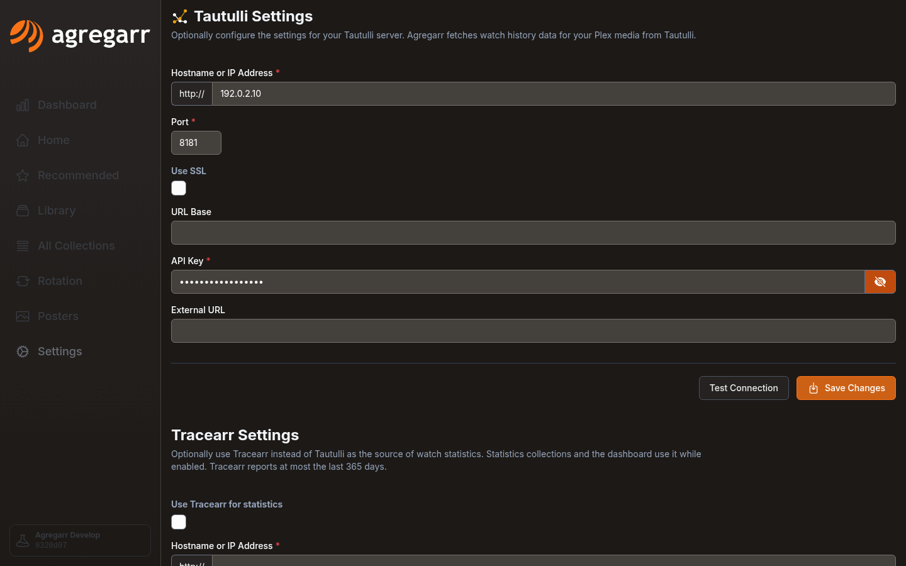
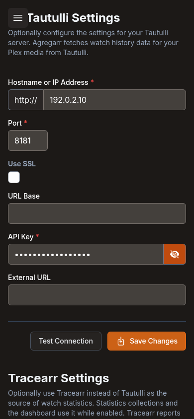
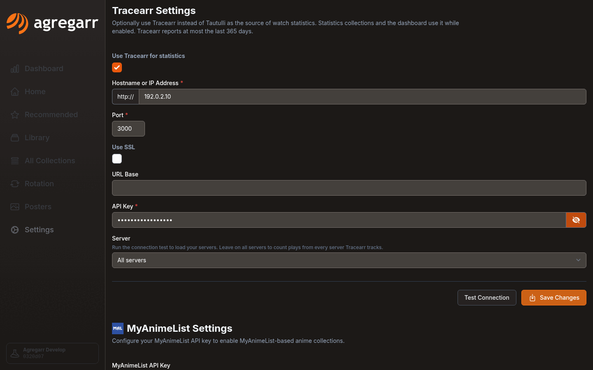
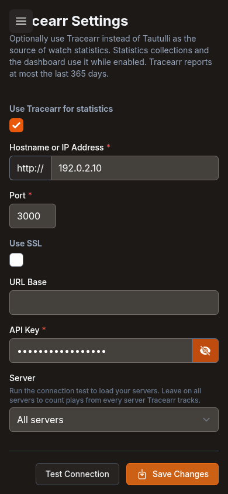

# Tautulli and Tracearr

Tautulli and Tracearr track watch history. Agregarr reads from one of them to build statistics collections, such as the most popular or most watched titles on your server, and to show play counts on the dashboard.

You only need one. Tracearr is the alternative. While it's switched on, it replaces Tautulli everywhere Agregarr reads statistics.

## What Agregarr uses them for

- **Statistics collections.** The **Tautulli Statistics** collection type gets its rankings from Tautulli. While Tracearr is switched on, it's relabelled **Tracearr Statistics**. See [Activity sources](../collections/sources/activity.md) for the sub-types and collection form.
- **Multiple Sources.** A statistics source inside a [Multiple Sources](../collections/sources/multiple-sources.md) collection uses whichever service is active.
- **The dashboard.** Weekly play counts and the **Collection Statistics** card come from the active service.

Agregarr only reads from these services. It doesn't change anything in them.

## Requirements

- Tautulli or Tracearr is running and already tracking your Plex server.
- Agregarr can reach it over the network. In Docker, `localhost` points to the Agregarr container itself. Use the other container's name or the host's IP address instead, for example `192.0.2.10`.
- An API key for the service you're connecting.
- For Tracearr, a release that has its public API.

## Get the credentials

1. In Tautulli, open **Settings**, then **Web Interface**, and find the **API Key** section. Copy the key.
2. In Tracearr, create an API key in its settings and copy it.
3. Note the address and port you use to open each service in a browser. Tautulli usually uses port `8181` and Tracearr usually uses port `3000`.

## Connect Tautulli

1. Open **Settings > Sources** and find **Tautulli Settings**.
2. Fill in **Hostname or IP Address**, **Port** and **API Key**. Fill in **Use SSL** and **URL Base** if your setup needs them.
3. Click **Test Connection**.

    **Check:** a green toast says **Connected to Tautulli successfully!**

4. Click **Save Changes**.

    **Check:** a green toast says **Tautulli settings saved successfully!**

=== "Desktop"

    

=== "Phone"

    

**Test Connection** stays greyed out until **Hostname or IP Address**, **Port** and **API Key** all have a value. It tests the values in the boxes without saving them.

During first-run setup, **Save Changes** stays greyed out until **Test Connection** passes with the values you entered. Once setup is finished, you can save without testing.

## Connect Tracearr

1. Open **Settings > Sources** and scroll to **Tracearr Settings**, below Tautulli.
2. Fill in **Hostname or IP Address**, **Port** and **API Key**. Fill in **URL Base** and **Use SSL** if your setup needs them.
3. Click **Test Connection**.

    **Check:** a green toast says **Connected to Tracearr successfully!** The **Server** list now contains the servers Tracearr tracks.

4. Leave **Server** on **All servers** to count plays from every server Tracearr tracks, or choose one.
5. Tick **Use Tracearr for statistics**.
6. Click **Save Changes**.

    **Check:** a green toast says **Tracearr settings saved successfully!** On the collection form, **Collection Type** now offers **Tracearr Statistics** where it previously showed **Tautulli Statistics**.

=== "Desktop"

    

=== "Phone"

    

Tracearr takes over only when **Use Tracearr for statistics** is ticked and both **Hostname or IP Address** and **API Key** are filled in. If either one is missing, Agregarr keeps reading from Tautulli.

## Tautulli options

### Hostname or IP Address (Tautulli)

Default: empty. Required. The address of Tautulli as Agregarr sees it, without `http://`. The grey prefix beside the box changes to `https://` when **Use SSL** is ticked.

### Port (Tautulli)

Default: `8181`. Required. The port Tautulli listens on.

### Use SSL (Tautulli)

Default: off. Tick it if you reach Tautulli over `https`.

### URL Base (Tautulli)

Default: empty. Use this when Tautulli sits behind a reverse proxy at a sub-path, for example `/tautulli`. It must start with `/` and must not end with `/`. If it doesn't follow that format, **Save Changes** stays greyed out and the box shows no message. Check this box first if you can't save.

### API Key (Tautulli)

Default: empty. Required. The key from Tautulli's web interface settings. The box hides the value.

### External URL (Tautulli)

Default: empty. The address you use to open Tautulli in your browser, if it differs from the **Hostname or IP Address** Agregarr uses. It must be a full address and must not end in a slash. If it doesn't follow that format, **Save Changes** stays greyed out and the box shows no message. Check this box first if you can't save. Statistics collections and the dashboard work without it.
<!-- OPEN: NEW: Tautulli External URL is only read to build a tautulliUrl field on Media (Media.ts:157-183), and nothing in src reads that field, so it has no visible effect -->

## Tracearr options

### Use Tracearr for statistics

Default: off. Switches every statistics collection and the dashboard from Tautulli to Tracearr. Existing collections created as **Tautulli Statistics** also read from Tracearr without needing edits. Untick it to switch back.

### Hostname or IP Address (Tracearr)

Default: empty. Required. The address of Tracearr as Agregarr sees it. It can't contain spaces, `/`, `:` or `@`.

### Port (Tracearr)

Default: `3000`. Required.

### Use SSL (Tracearr)

Default: off. Tick it if you reach Tracearr over `https`.

### URL Base (Tracearr)

Default: empty. A sub-path for Tracearr behind a reverse proxy. It must start with `/` and must not end with `/`.

### API Key (Tracearr)

Default: empty. Required. The key you created in Tracearr. The box hides the value.

### Server

Default: **All servers**. Counts plays from every server Tracearr tracks. **Test Connection** fills the list with each server's name and type. Choose one to count plays from that server only. If you saved a server earlier, the list shows its ID until you click **Test Connection** again.

## What Agregarr writes in Tautulli and Tracearr

Nothing. Agregarr only reads from them. It creates no users, tags or requests in either service.

## Limits

- **Tracearr reports at most the last 365 days.** Agregarr caps longer ranges at 365. On the dashboard, the **Days:** box accepts 1 to 365 while Tracearr is switched on and 0 to 9999 otherwise. Statistics collections use **Number of Days**, from 1 to 365 for both services.
- **Tracearr results are cached for 5 minutes.** Changes in Tracearr can take a few minutes to appear in the next sync.
- **A Tracearr list is cut at 5,000 titles.** Agregarr reads up to five pages of 1,000 titles for each list. That's far more than any collection holds.
- **Both services rank by different people, not plays, for Most Popular.** [Activity sources](../collections/sources/activity.md#tautulli-statistics-and-tracearr-statistics) covers the ranking and **Minimum Play Count**.
- **Collection stats on the dashboard only cover collections Agregarr knows about.** That includes collections it created and pre-existing collections it manages.

## If it didn't work

- **The test says "Invalid API key - Authentication failed".** The key is wrong or the service rejected it. Copy it again from Tautulli or Tracearr.
- **Tautulli's test message ends with an address in brackets.** That's the address Agregarr tried, built from **Use SSL**, **Hostname or IP Address**, **Port** and **URL Base**. Open it in a browser from the same network as Agregarr to check the address.
- **The box says "You must provide a valid hostname or IP address".** The value contains `http://` or a path. Enter only the name or IP address, then use **Use SSL** and **URL Base** for the rest.

For Tautulli:

- **"Connection refused - Check hostname and port".** Nothing is listening at that address. In Docker, check that you didn't use `localhost`.
- **"Host not found - Check hostname".** The name doesn't resolve inside the Agregarr container. Use an IP address or a name on a shared Docker network.
- **"Tautulli API not found - Check URL base and port".** Tautulli answered at that address, but not at that path. Check **URL Base**.
- **Tracearr's test fails with a message starting `[Tracearr] /servers failed`.** The rest of the message contains the network error. `ECONNREFUSED` means nothing is listening at the address, or you're using `localhost` in Docker. `ENOTFOUND` means the name doesn't resolve. A 404 means **URL Base** or **Port** is wrong, or that Tracearr release has no public API.
- **The dashboard shows Tautulli Setup Required.** The **Configure Tautulli** button on the card opens **Settings > Sources**. The card also appears when Tautulli is configured but Agregarr can't reach it.
- **The dashboard shows Tracearr Connection Failed.** The card reads "Agregarr could not read statistics from Tracearr". Click **Check Tracearr Settings**, then run **Test Connection**. Untick **Use Tracearr for statistics** to switch back to Tautulli.
- **"Tautulli required." shows under Collection Type.** No Tautulli API key is saved and Tracearr isn't switched on with a hostname and key. The warning's **Configure Settings** button opens **Settings > Sources**.
- **A statistics collection fails with "not configured".** The message identifies the missing Tautulli or Tracearr API key or hostname. Fill in both and save.

## Related

- [Activity sources](../collections/sources/activity.md)
- [Multiple Sources](../collections/sources/multiple-sources.md)
- [Setup wizard](../get-started/setup-wizard.md)
- [Health Checks](../Health-Checks.md)
