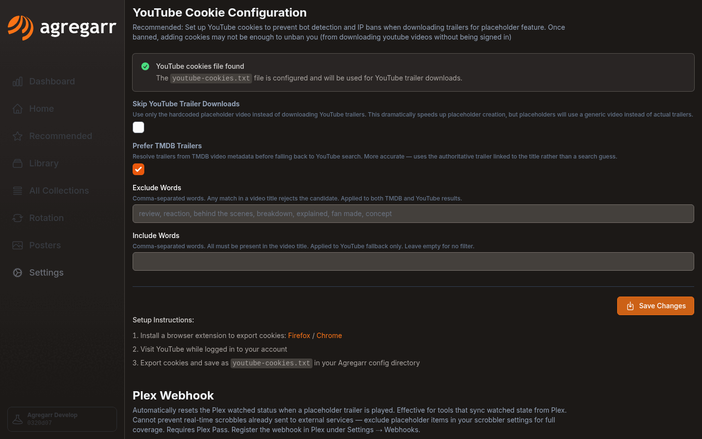
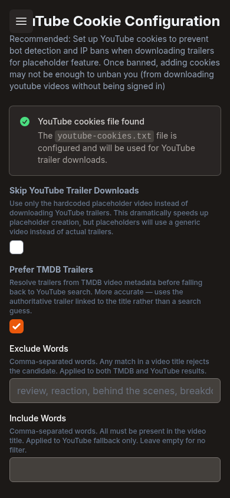

# Trailers and YouTube cookies

Every placeholder Agregarr creates plays a trailer. This page covers where the trailer comes from and the settings that control it.

## What Agregarr uses trailers for

A placeholder is a short video file Agregarr puts in your Plex library for a movie or show you don't have yet. It lets the item appear in a collection with an overlay such as a release date. The video is that title's trailer. [Placeholders](../Placeholders.md) explains the files, folders and labels. This page only covers the video.

Agregarr looks for a trailer in this order. It stops at the first option that works:

1. **The built-in video.** If **Skip YouTube Trailer Downloads** is on, Agregarr uses a generic video that ships with it. It doesn't check TMDB or YouTube.
2. **TMDB's own list of videos for the title.** Agregarr uses this when **Prefer TMDB Trailers** is on and it knows the item's TMDB ID. Only YouTube videos typed Trailer or Teaser count. Agregarr drops any video whose name matches **Exclude Words**. It puts trailers before teasers, official uploads before unofficial ones and newer videos before older ones. It tries up to three and accepts a video that runs under 10 minutes.
3. **A YouTube search.** Agregarr searches for the title, year and "official trailer", then checks the top 10 results. It takes the first result whose title passes the word lists and downloads it if it runs under 3 minutes 30 seconds. If that download breaks or the video is too long, it doesn't try the next result.
4. **The built-in video again.** Agregarr uses this when the search finds nothing, no result passes the word lists or the chosen video can't be downloaded.

Agregarr downloads the video to a temporary folder, copies it into the placeholder's folder and deletes the temporary file.

Downloads are capped at 1080p.

Agregarr ships with the tools it needs (yt-dlp and ffmpeg). You don't need to install anything.

## Requirements

- Nothing to turn on. Trailers work without any setup.
- A `youtube-cookies.txt` file is recommended. YouTube can block downloads from a server as bot traffic. Cookies from a signed-in browser make the downloads look like yours.

## Set it up

### Choose how trailers are found

1. Go to **Settings > Downloads** and scroll to the trailer settings under **YouTube Cookie Configuration**.
2. Set the options below.
3. Click **Save Changes**.

    **Check:** a toast reads "YouTube settings saved successfully!"

=== "Desktop"

    

=== "Phone"

    

This form saves on its own. **Save Changes** here doesn't save edits in the other forms on **Settings > Downloads**.

### Add a YouTube cookies file

1. Sign in to YouTube from a desktop browser.
2. Install a browser extension that exports cookies in Netscape format. **YouTube Cookie Configuration** links to one for Firefox and one for Chrome under **Setup Instructions:**.
3. Open a YouTube page, export the cookies and save the file as `youtube-cookies.txt`.
4. Put the file in Agregarr's config folder. This is the folder you mapped to `/app/config` in your container, for example `/mnt/user/appdata/agregarr`.
5. Reload **Settings > Downloads**.

    **Check:** a green message reads **YouTube cookies file found**.

The first line of the file has to read `# Netscape HTTP Cookie File` or `# HTTP Cookie File`. Agregarr treats anything else as invalid.

Treat this file like a password. It holds your YouTube sign-in.

## Options

### Skip YouTube Trailer Downloads

Default: off. When turned on, every placeholder uses the built-in video. Agregarr skips TMDB and YouTube completely, which makes placeholder creation much faster. The trailer fields below are greyed out while it's on.

### Prefer TMDB Trailers

Default: on. Agregarr checks TMDB's video list before searching YouTube. TMDB links the official trailer to the title, so this is more accurate than a search. Turn it off to go straight to the YouTube search. Greyed out while **Skip YouTube Trailer Downloads** is on.

### Exclude Words

Default: empty, which uses the built-in list `review, reaction, behind the scenes, breakdown, explained, fan made, concept`. Separate words with commas. Agregarr rejects a video when its title contains any of them, in both the TMDB and YouTube steps. Matching ignores case. Anything you enter here replaces the built-in list, so include any of those words you still want blocked.

### Include Words

Default: empty, which applies no filter. Separate words with commas. A YouTube result's title has to contain all of them. Matching ignores case. This only applies to the YouTube search, not TMDB.

### Save Changes

Saves these four fields. The cookies file isn't a setting here. It's a file you put in the config folder.

## What the screen tells you about cookies

**YouTube Cookie Configuration** shows one message at the top. Agregarr checks the file each time you open the page:

- **YouTube cookies file not found.** There is no `youtube-cookies.txt` in the config folder.
- **YouTube cookies file is not valid.** The file is empty, can't be read or doesn't start with the Netscape header. Agregarr ignores it and downloads without cookies.
- **YouTube cookies file found.** Agregarr passes the file to every YouTube download and search.
- **YouTube cookies are configured, but YouTube trailer downloads are disabled below.** The file is fine, but **Skip YouTube Trailer Downloads** is on, so nothing uses it.

The collection form shows the same status when you create placeholders. With **Skip YouTube Trailer Downloads** off and no valid file, it shows **YouTube Cookies Not Configured** with a link to **Settings > Downloads**. With **Skip YouTube Trailer Downloads** off and a valid file, it shows **YouTube Cookies Configured**. With **Skip YouTube Trailer Downloads** on, it shows neither message.

## What Agregarr writes in those services

Nothing in TMDB or YouTube. Agregarr only reads from them. On disk, it saves each downloaded trailer to a temporary folder in Agregarr's config folder, then copies it into the placeholder.

## Limits

- These settings apply to placeholders created after you save them. A placeholder keeps the video it was made with.
- The YouTube step only tries one result. A video that's too long or a failed download sends the placeholder to the built-in video.
- Cookies help but don't guarantee downloads. Once YouTube blocks your server's address, adding cookies might not lift the block.
- Agregarr never uploads or changes anything on your YouTube account.

## If it didn't work

**Every placeholder plays the same generic video.** Check **Skip YouTube Trailer Downloads** first. If it's off, the search found nothing or the download broke. Check **Settings > Logs** for "PlaceholderService" lines from around the time the placeholder was made.

**The page says the cookies file isn't found.** The file isn't in the folder mapped to `/app/config`, or it has a different name. The name has to be exactly `youtube-cookies.txt`.

**The page says the cookies file isn't valid.** Export it again in Netscape format. Open it in a text editor and check the first line. It has to be the Netscape header.

**Downloads fail with bot or sign-in errors in the log.** YouTube is blocking the server. Add cookies from a signed-in browser. If cookies are already there, export a fresh set.

**I changed Exclude Words or Include Words but existing placeholders still have the old video.** These settings only apply to placeholders created after you save them.

**The trailer is the wrong video.** Add words to **Exclude Words** to block that kind of upload, or add a word to **Include Words** that the right title always contains.

## Related

- [Placeholders](../Placeholders.md)
- [Coming Soon](../collections/sources/coming-soon.md)
- [Settings](../Settings.md#downloads)
- [Health Checks](../Health-Checks.md)
