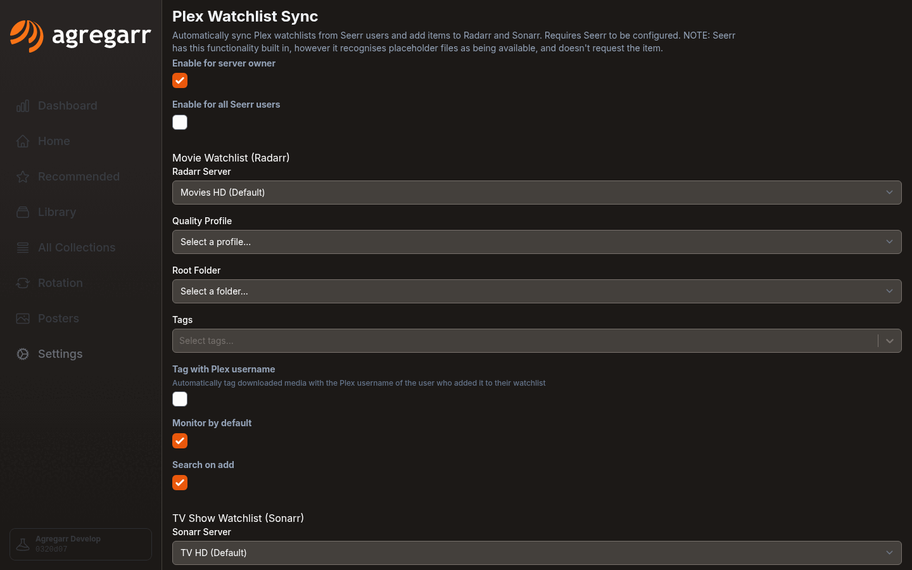
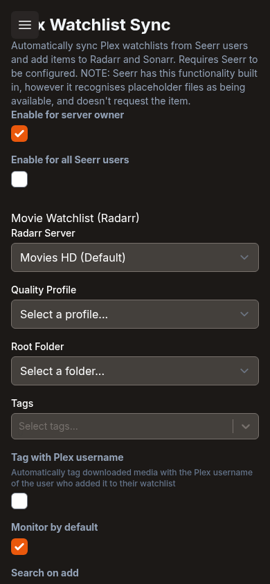

# Plex Watchlist Sync

Plex Watchlist Sync takes what your users add to their Plex watchlists and sends it straight to Radarr and Sonarr, without creating a Seerr request.

## What Agregarr uses it for

Agregarr gets each user's Plex watchlist from Seerr, then adds movies to Radarr and shows to Sonarr directly. Seerr can do this itself, but it treats a placeholder file as a real copy. That means it won't request an item when Agregarr has already made a placeholder for it. Sending the item straight to Radarr or Sonarr avoids that.

Nothing is requested in Seerr. Agregarr only uses Seerr for the user list and watchlists.

## Requirements

- Seerr connected under **Settings > Downloads**. The two checkboxes stay greyed out until it's connected. See [Seerr](../services/seerr.md).
- At least one Radarr or Sonarr server connected under **Settings > Downloads**. See [Radarr](radarr.md) and [Sonarr](sonarr.md).
- Users who exist in Seerr. Only Seerr users are synced.

## Set it up

1. Go to **Settings > Downloads** and scroll to **Plex Watchlist Sync**.
2. Tick **Enable for server owner**, **Enable for all Seerr users** or both.

    **Check:** the **Movie Watchlist (Radarr)** and **TV Show Watchlist (Sonarr)** sections appear below.

3. In **Movie Watchlist (Radarr)**, choose a **Radarr Server**.
4. In **TV Show Watchlist (Sonarr)**, choose a **Sonarr Server**. Leave either section on **Select a server...** to skip that kind of media.
5. Set the options you want (see below). Blank options use that server's own default.
6. Click **Save Changes**.

    **Check:** a toast reads "Watchlist sync settings saved successfully".

=== "Desktop"

    

=== "Phone"

    

7. Go to **Settings > Jobs** and click **Run Now** on **Plex Watchlist Sync** to try it straight away.

    **Check:** the row's **Last Run** badge shows **Success**. After you reload the page, **Last Sync** on the form shows a date.

The form saves separately. **Save Changes** here doesn't save edits in the other forms under **Settings > Downloads**.

## Options

### Enable for server owner

Default: off. Syncs the Seerr admin account's watchlist. Greyed out until Seerr is connected.

### Enable for all Seerr users

Default: off. Syncs the watchlist of every other Seerr user. Greyed out until Seerr is connected. Tick it with **Enable for server owner** to sync everyone.

### Movie Watchlist (Radarr)

Appears when either box above is ticked. If no Radarr server is connected, a warning reading **No Radarr servers configured** appears instead of the fields. Movies only sync after you choose a **Radarr Server**.

#### Radarr Server

Default: **Select a server...**, which leaves movies out. Servers marked **(Default)** or **(4K)** show that next to their name.

#### Quality Profile

Default: **Select a profile...**, which uses the chosen server's default profile. Appears after you choose a server.

#### Root Folder

Default: **Select a folder...**, which uses the server's default root folder.

#### Tags

Default: none, which uses the server's own default tags. If you choose tags and then clear them all, the server's default tags stop applying and movies are added without tags. To use the server defaults again, choose the tags again by hand.

Choose an existing tag or type a new name and select **Add new tag**. Radarr creates a new tag straight away, before you save.

#### Tag with Plex username

Default: off. Adds a tag named after the Plex username of the person whose watchlist the movie came from. Agregarr creates the tag in Radarr if it doesn't exist. If Seerr has no Plex username for that user, no tag is added.

#### Monitor by default

Default: ticked. Sets whether the added movie is monitored.
<!-- OPEN: NEW: Monitor by default, Search on add and Season folders show ticked when unset, but the server falls back to the Radarr or Sonarr server's own setting -->

#### Search on add

Default: ticked. Sets whether Radarr starts looking for the movie as soon as it's added.

### TV Show Watchlist (Sonarr)

Works the same way as the movie section. It has **Sonarr Server**, **Quality Profile**, **Root Folder**, **Tags**, **Tag with Plex username**, **Monitor by default** and **Search on add**, plus one extra option. If no Sonarr server is connected, a warning reading **No Sonarr servers configured** appears.

#### Season folders

Default: ticked. Sets whether Sonarr puts each season of the added show in its own folder.

### Last Sync

A green badge under the form reading **Last Sync:** followed by the date and time of the last completed run, in your browser's time zone. It only appears after a run finishes.

### Save Changes

Saves this form only. Choosing a server turns that section on. Clearing it turns the section off.

## The job

**Plex Watchlist Sync** under **Settings > Jobs** runs every 6 hours by default. Click **Edit** to choose a preset of 1, 2, 3, 4, 6, 8, 12, 24 or 48 hours (or enter a CRON expression). Click **Run Now** to run it once.

If neither **Enable for server owner** nor **Enable for all Seerr users** is ticked, the job skips each run.

For each watchlist item the job:

1. Skips it if the movie or show is already in Radarr or Sonarr.
2. Skips it if Radarr or Sonarr has it on its exclusion list.
3. Skips it if another user's watchlist already caused it to be added during the same run.
4. Adds it with the settings above.

A TV show also needs a TVDB ID, which Agregarr looks up through TMDB. A show without one is skipped.

## What Agregarr writes in those services

- **Radarr and Sonarr:** a new movie or show for each watchlist item that passes the checks above, using the quality profile, root folder, tags, monitoring and search settings from the form.
- **Tags:** a tag named after the user's Plex username when **Tag with Plex username** is on, plus any new tag you create from the **Tags** box.
- **Seerr:** nothing. Agregarr reads users and watchlists but creates no request.
- **Plex:** nothing. Agregarr never edits a watchlist.

## Limits

- It only adds. Removing an item from a watchlist or a user leaving Seerr doesn't remove anything from Radarr or Sonarr.
- Agregarr reads watchlists through Seerr, not directly from Plex.
- Agregarr reads each user's watchlist from Seerr in one request, with no page number. If Seerr only returns the first page, items further down a long watchlist are never added.
<!-- OPEN: NEW: check live against a watchlist longer than one page (overseerr.ts:880 has no page parameter) -->
- Shows are added whole. You can't choose individual seasons.
- All users share one Radarr server and one Sonarr server.

## If it didn't work

**The checkboxes are greyed out.** Seerr isn't connected. Connect it under **Settings > Downloads** first.

**The run succeeds but nothing is added.** Open **Settings > Logs** and search for "Watchlist Sync". Check for these causes:

- No server is chosen in either section. The log says "Watchlist sync enabled but no Radarr/Sonarr server selected for watchlist sync". The job still shows **Success**.
- Every item is already in Radarr or Sonarr or appears on an exclusion list.
- Seerr didn't answer. Agregarr logs the failure and carries on, so the job still shows **Success**.

**Items go to the wrong Radarr or Sonarr server.** Check the **Radarr Server** and **Sonarr Server** choices, then click **Save Changes** again.
<!-- OPEN: NEW: addMovieToRadarr and addShowToSonarr treat serverId 0 as unset, so the first server added falls back to the default server -->

**Movies arrive unmonitored or without a search.** The server's own settings apply until you change the checkboxes here. Tick or untick **Monitor by default** and **Search on add**, then click **Save Changes**.

**Tags are missing.** **Tag with Plex username** only adds a tag when Seerr has the user's Plex username.

## Related

- [Radarr](radarr.md)
- [Sonarr](sonarr.md)
- [Seerr](../services/seerr.md)
- [Settings](../Settings.md#downloads)
- [Settings > Jobs](../Settings.md#jobs)
- [Placeholders](../Placeholders.md)
